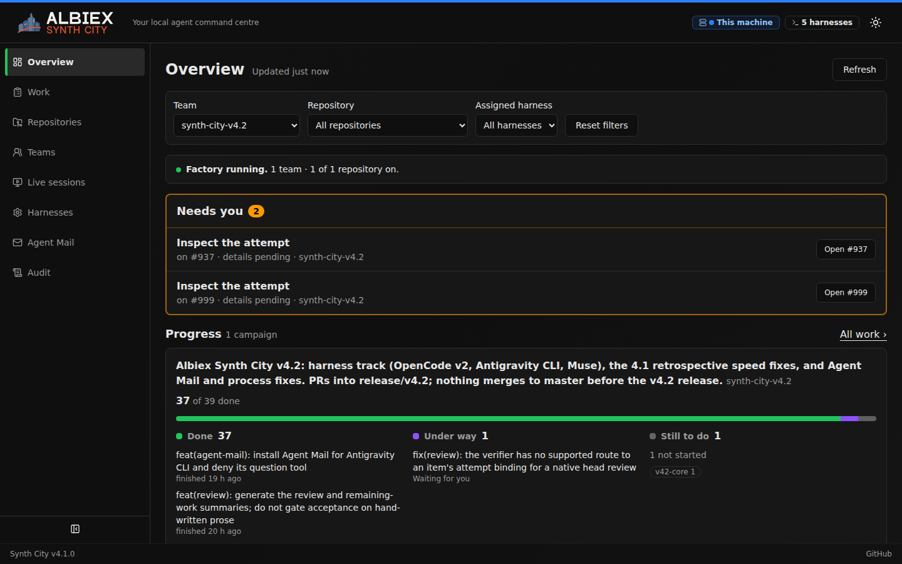
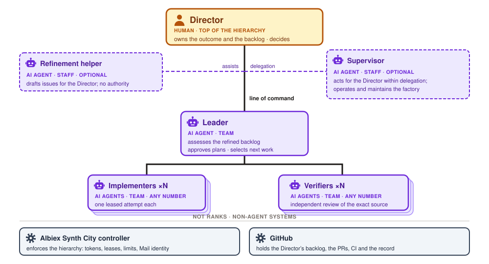
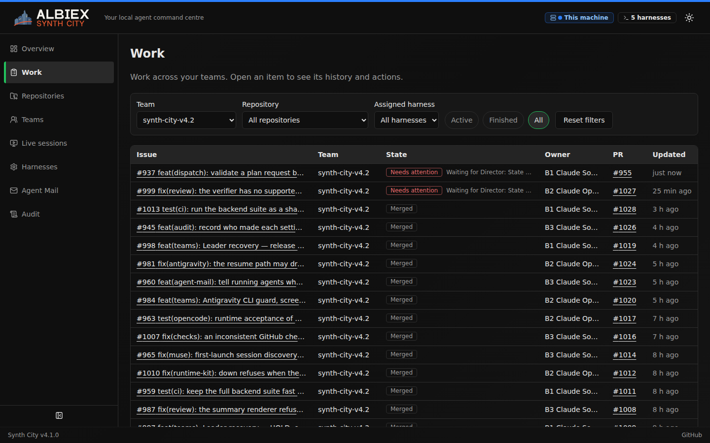

> **Albiex Synth City** — formerly Claude Deck. This repository moved here from `adrirubio/claude-deck`; old links redirect. Upgrading from v3.1? Read the [migration guide](docs/guide/migration-v4.md) first.

# Albiex Synth City

[](https://github.com/albiexai/synth-city/releases)
[](#license)
[](https://albiex.org/docs)

**Run teams of AI coding agents on your GitHub backlog, and stay in charge.**

Synth City is a self-hosted software factory for coding agents. You label GitHub
issues, and your teams of agents plan, build and review them in your own
repositories, on your own machine. Run several teams side by side, each on its
own repositories or issue labels, and mix agents freely: Claude Code, Codex CLI,
OpenCode, GitHub Copilot CLI, Pi and Muse Code. In every team a Leader agent
approves each plan, builders work in separate workspaces, and a reviewer agent
checks every pull request. Nothing merges until the reviewer has accepted that
exact commit and CI is green. You watch the whole factory in one web UI and
step in when you want to.



## What you get

- **A backlog that works itself.** Label an issue and it is planned, built, reviewed and merged, or stopped with a clear reason.
- **Review built in.** Automatic merge needs the reviewer's acceptance of the exact head, green required checks and no hold label.
- **Limits you can see.** An effort limit per item, a daily merge cap, hold labels, and stop messages that agents must read before they can edit.
- **Recovery, not restarts.** Standard actions for stuck items and stale sessions, and an audit trail of who did what.
- **Agents that talk.** Agent Mail gives every agent an inbox for handoffs, questions and reviews.
- **Your agent setups in one place.** Edit Claude Code and Codex settings, MCP servers, hooks, permissions, skills and more.

## Who it's for

Developers and small teams who already use coding-agent CLIs and want them to work through a backlog with review and limits, not as unattended scripts. Run it on the machine where your agents, credentials and repositories live. Linux is recommended.

## Your machine, your keys

- Runs locally. No Synth City account, no cloud service, no telemetry.
- Agents use your own CLI logins and model credentials. GitHub uses your token or GitHub App.
- Synth City edits your real agent configuration files. Use the built-in Backup & Restore before big changes.
- It is a single-operator tool, protected by your Director key. For remote access, use a trusted network or tunnel, not the open internet.

## How a factory works

You are the **Director**: you own the backlog and make the decisions that matter. Each **team** has one **Leader**, who approves plans and coordinates, plus the number of **builders** and **reviewers** you choose. An optional **Supervisor** agent can act for you within the limits you set. Rule-based work (dispatch, workspace leases, Mail delivery, merge gates) is done by Synth City itself, not by an agent. GitHub holds the issues, pull requests and record.



Read more in the [Factory operating model](docs/guide/operating-model.md), [Autonomous GitHub dispatch](docs/autonomy.md) and the [Supervised factory playbook](docs/guide/supervised-factory-playbook.md).

## Quick start

**Prerequisites:** Python 3.11+, Node.js 22.12+, tmux, and at least one supported agent CLI on the same host.

Running the frontend tests needs a newer Node.js than the installer checks for: 22.22.2 or later in the 22 line, 24.15 or later in the 24 line, or 26 and later (jsdom 31). Node.js 23 and 25 are not supported for the tests.

```bash
git clone https://github.com/albiexai/synth-city.git
cd synth-city
./scripts/install.sh
./scripts/dev.sh
```

Open http://localhost:5173. Then:

1. **Harnesses**: check that your agent CLIs are found and configured.
2. **Repositories → Set up a repository**: connect a GitHub repository and its labels.
3. **Teams**: choose the Leader, builders and reviewer, and launch the team.
4. Label an issue as ready, and follow it on **Overview** and **Work**.

See the [Quick start guide](docs/guide/quick-start.md) and [Installation](docs/guide/installation.md) for details, production builds and upgrades.

> [!NOTE]
> Run Synth City natively, on the host where your agents run. Docker is not supported: a container cannot see host CLIs, tmux sessions or credentials. Some team features read `/proc` and need Linux; on macOS and Windows everything else works.

## Features

**The factory**

- **Overview and Work**: every team's work items in one place, with owners, waiting reasons, PRs and the next step.
- **Repositories**: watched repositories, labels, intake, polling and the merge policy.
- **Teams**: rosters, launch plans, the Leader, autonomy and recovery.
- **Agent Mail**: inboxes, handoffs and context requests between agents, with an inspectable team mailbox.
- **Live sessions**: watch and type into up to four agent terminals at once.
- **Audit and metrics**: a ledger of the factory's actions and outcomes.

**Agent configuration**

Harness pages for each supported agent; the Claude Code and Codex settings editors; MCP servers (with the [MCP Registry](https://registry.modelcontextprotocol.io)); slash commands; plugins; hooks; permissions; agents; skills (with [skills.sh](https://skills.sh)); memory; output styles; the status line; session transcripts; usage and cost tracking; plan history; projects; and Backup & Restore.

**Harnesses:** Claude Code, Codex CLI, GitHub Copilot CLI, OpenCode 2, Pi and Muse Code. Antigravity CLI is in preview and can't yet join a team. Support varies by harness; see [Harnesses](docs/features/harnesses.md).

## What's new

Version 4.2 makes the factory explain itself: it reports stuck work and automatic merges that didn't run, records effort limits, and gives the Leader standard recovery actions. See the [changelog](CHANGELOG.md).

## Screenshots

**Work**: every item across your teams, with its state, owner and pull request.



## Tech stack

FastAPI and SQLite (async SQLAlchemy) on Python 3.11+; React 19, TypeScript 6, Vite 8, shadcn/ui and Tailwind CSS 4 in the browser.

## Contributing

See [CONTRIBUTING.md](CONTRIBUTING.md) for setup, style and pull request guidelines. API documentation is at http://localhost:8000/docs while the dev server runs. Issues and feature requests are welcome.

## Built by

[Adrian](https://github.com/adrirubio) (13) and [Juan](https://github.com/juanrubio) during the 2025 Christmas break as a learning project — to explore open source, Claude Code, and full-stack development together.

## Acknowledgments

The session transcript viewer was inspired by and includes code adapted from [claude-code-transcripts](https://github.com/simonw/claude-code-transcripts) by [Simon Willison](https://simonwillison.net/).

The usage tracking feature ports algorithms from [ccusage](https://github.com/ryoppippi/ccusage) by [ryoppippi](https://github.com/ryoppippi), including session block identification, tiered pricing, and burn rate projections.

## License

MIT License
