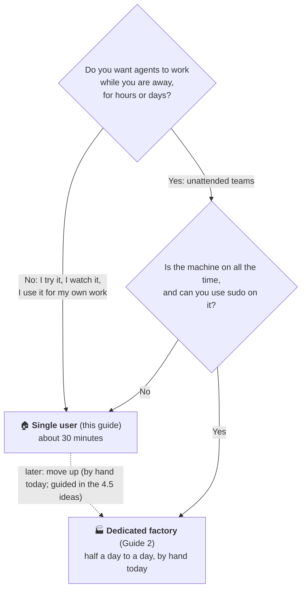
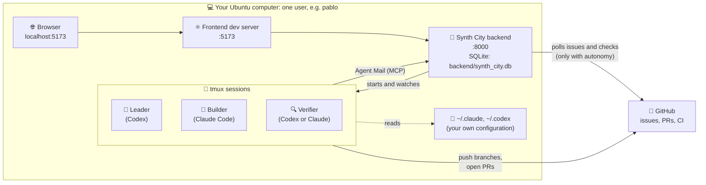
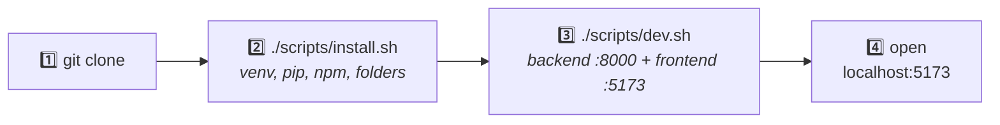
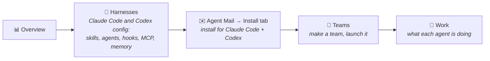
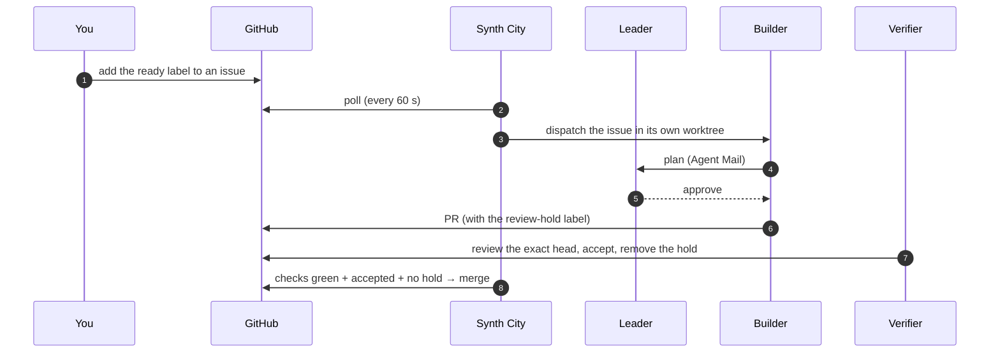
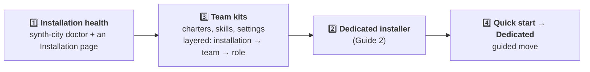

# 🏠 Guide 1 — Albiex Synth City on one user account ("Quick start")

> [!NOTE]
> **Status: current situation, 22 Nov 2026 (Synth City 4.3.0, 4.4 in preparation).** This guide describes what works **today** and the ideas for the 4.5 installation programme. It is a thinking aid for planning 4.5, and a guide for a first install on Ubuntu with **Claude Code** and **Codex**.
> The companion guides are **Guide 2 — a dedicated factory** and **Guide 3 — operating the factory** (what to configure right after installing).

---

## 1. Which setup do you want?



| | 🏠 Single user | 🏭 Dedicated factory |
|---|---|---|
| **Who runs what** | You, Synth City and the agents are **one Linux user** | Synth City runs as a **controller user**; agents run as a separate **agent user** |
| **Starts with** | `./scripts/dev.sh` in a terminal | `systemd` services, at boot |
| **Survives logout or reboot** | ❌ No | ✅ Yes |
| **Secrets safe from agents** | ❌ No: agents can read `backend/.env` | ✅ Yes: the operator token is out of the agents' reach |
| **Install effort today** | 🟢 Low: one script | 🔴 High: about 12 manual steps |
| **Good for** | Learning, supervised teams, small projects | Long campaigns with no one watching |
| **Recommended first step** | ✅ **Start here** | After you know Synth City |

> [!TIP]
> **Recommendation for a first install: start with this guide.** Everything you learn here carries over to a dedicated factory. Teams, Agent Mail, autonomy and auto-merge all work in single-user mode.

---

## 2. What you get



- **Synth City** is a web app (FastAPI and React) that shows and changes your Claude Code and Codex configuration, and runs **agent teams** in `tmux`.
- **Agent Mail** is how the agents talk to each other and to you. It is an MCP server plus hooks, installed into each harness.
- **Autonomy** is optional. Synth City watches a GitHub repository, gives labelled issues to builders, and can merge accepted PRs.

---

## 3. Before you start: prerequisites on Ubuntu

| Need | Minimum | Ubuntu 24.04 | Ubuntu 22.04 | Check |
|---|---|---|---|---|
| 🐍 Python | **3.11** | ✅ 3.12 built in | ⚠️ 3.10: add 3.11 or later (deadsnakes PPA) | `python3 --version` |
| 🟩 Node.js | **22.12** (tests: 22.22.2+ or 24.15+) | ⚠️ apt is too old: use **nvm** or NodeSource | same | `node --version` |
| 🧵 tmux | any current | ✅ apt | ✅ apt | `tmux -V` |
| 🌿 git | any current | ✅ apt | ✅ apt | `git --version` |
| 🐙 GitHub CLI | for autonomy | ✅ apt `gh` | ✅ apt `gh` | `gh --version` |
| 🤖 Claude Code | current | npm or the native installer | same | `claude --version` |
| 🤖 Codex CLI | current | npm | same | `codex --version` |
| 🔑 Subscriptions | Claude and ChatGPT accounts that include Claude Code and Codex | | | log in once in each CLI |

<details>
<summary>📋 Commands (Ubuntu 24.04)</summary>

```bash
# Base tools
sudo apt update
sudo apt install -y git tmux python3 python3-venv python3-pip gh curl

# Node.js 22 with nvm (no sudo needed)
curl -o- https://raw.githubusercontent.com/nvm-sh/nvm/v0.40.3/install.sh | bash
source ~/.bashrc
nvm install 22
node --version      # must be v22.12 or later

# The two agent harnesses
npm install -g @anthropic-ai/claude-code
npm install -g @openai/codex

# Log in to each one (opens a browser)
claude              # then follow the login prompt; type /exit when done
codex login

# GitHub (needed for autonomy and PRs)
gh auth login
```
</details>

> [!IMPORTANT]
> **Linux matters.** Synth City finds which `tmux` pane an agent runs in by reading `/proc`. On Ubuntu this works fully. On macOS or native Windows, agents cannot be bound to their panes, and the Agent Mail token check cannot be turned on.

---

## 4. Install in four commands



```bash
git clone https://github.com/albiexai/synth-city.git
cd synth-city
git checkout v4.3.0          # the latest release (4.4 is coming)
./scripts/install.sh
./scripts/dev.sh             # keep this terminal open
```

Open **http://localhost:5173**. Stop with `./scripts/dev.sh stop`.

| What `install.sh` does | Where |
|---|---|
| Checks Python 3 and Node.js 22.12+ | — |
| Creates a Python virtual environment and installs the backend dependencies | `backend/venv/` |
| Installs the frontend and docs dependencies | `frontend/node_modules`, `docs/node_modules` |
| Creates the backup folder | `~/.albiex-synth-city/backups/` |

> [!NOTE]
> No `.env` file is needed to start. All settings have defaults in `backend/app/config.py`. The database is created on first start at `backend/synth_city.db`.

---

## 5. First tour (no GitHub needed)



1. **Harnesses**: look at your Claude Code and Codex configuration. Nothing changes until you save.
2. **Agent Mail → Install**: install the integration for **Claude Code** and **Codex CLI**. Restart any open agent sessions. In each one, ask the agent to call `synth_city_whoami` once.
3. **Teams**: create a small team (a Leader, one builder, one verifier) for a repository you own, and launch it. Each member opens in its own `tmux` session.
4. **Live sessions**: watch and type into any member's terminal from the browser.

---

## 6. Optional: let the team pick up GitHub issues (autonomy)



| Step | What to do |
|---|---|
| 🔑 Operator token | `openssl rand -hex 32` → put `operator_token=<value>` in `backend/.env`, then `chmod 600 backend/.env`. The UI asks for it for roster, scope and autonomy changes. |
| 🐙 GitHub token | `github_token=<token>` in `backend/.env` (for example from `gh auth token`). Restart the backend. |
| 🏷️ Labels | On GitHub, create a ready label, and optionally a design label and a review-hold label. |
| 📂 Watched repository | **Repositories**: add the repository, its main clone (under your home folder), base branch, merge policy (human or auto) and limits. |
| 🧱 Dispatch workspaces | Register one workspace per item that may run at once (a folder beside the main clone). **With none, nothing is dispatched, and no error is shown.** |
| 👥 Roster | One slot with role `verifier` is needed for auto-merge. Give the builders **area labels** that match the issue labels. |
| ▶️ Autonomy | Turn it on in Teams when the roster and repositories are ready. |

> [!WARNING]
> **In single-user mode the agents run as you.** Any agent can read `backend/.env`, so the operator token does **not** protect against your own agents. Use autonomy on your own repositories and keep an eye on it. This is the main reason for a dedicated factory.

---

## 7. Where things stand (single user)

| Area | Today | Notes |
|---|---|---|
| Install script | ✅ Works | Checks only Python and Node. It does not check tmux, git, gh, the harnesses or their logins. |
| Start and stop | 🟡 By hand | `dev.sh` runs dev servers in your terminal. It is not a service and stops when you log out. |
| Agent Mail install | ✅ One click per harness | Restart the sessions afterwards. After an upgrade, re-check the Install tab; new hooks are not added by themselves. |
| Team launch | ✅ Works | Codex sessions launched fresh show `restart_needed_for_observation` until they are restarted once in resume mode. |
| Folder trust | ✅ Prepared at launch | Synth City prepares Claude and Codex trust for team folders. |
| Health check | ❌ None | No "doctor" yet. A problem shows up as a stuck launch or an item that never dispatches. |
| Upgrades | 🟡 By hand | `git pull` or `git checkout <tag>`, `./scripts/install.sh`, restart. Back up `backend/synth_city.db` first. |
| Security boundary | ⚠️ None | Agents share your user and can read your secrets. |
| Move to dedicated | ❌ By hand | See Guide 2. |

### Problems we have hit, and how to spot them

| Symptom | Likely cause | What to do |
|---|---|---|
| An issue with the ready label stays `pending` | No dispatch workspace registered, or no builder's area label matches | Register a workspace; check the labels |
| An agent waits forever on a question | It used an interactive question tool that no one answers | Answer in its pane; Synth City blocks it for Claude Code team members |
| Codex member shows "activity unknown" | Launched fresh, not yet observed | Restart it once from Synth City (resume) |
| Agent Mail tools missing after an upgrade | New hooks were not installed | Agent Mail → Install, then restart the sessions |
| `dubious ownership` from git | The folder belongs to another user | `git config --global --add safe.directory <folder>` |

---

## 8. Ideas for 4.5 (Quick start mode)

> [!NOTE]
> These are **ideas under discussion** from the installation programme (decided in outline on 16 Nov 2026, design draft in PR #978). Nothing below is built yet.



| Idea | What it would change for a single-user install |
|---|---|
| 🩺 `synth-city doctor` | One command checks Python, Node, tmux, git, each harness and its login, Agent Mail hooks, folder trust, `safe.directory`, GitHub access and the base branch's CI. Each failure shows its fix. |
| 📋 Installation page | The same checks in the UI, with one-click fixes for things Synth City owns (for example, repair Agent Mail). |
| 🧰 A better `install.sh` | It checks tmux, git, gh and the harnesses, offers to install Agent Mail, and ends by running the doctor. |
| ▶️ Run as a user service | Optionally, `systemd --user` units, so single-user mode survives a closed terminal. |
| 👥 Team kits | Start a team from a kit with charter templates, so you don't write charters from scratch (4.4 ships the first templates, #1113). |
| ⬆️ Guided move to dedicated | Keep your teams and history when you move up to a dedicated factory. |

### Questions to decide before the 4.5 campaign

1. Should Quick start install **release builds** (no dev servers, the backend serves the built UI, as the factory does) instead of `dev.sh`?
2. Should `install.sh` offer to install Claude Code and Codex, or only check for them?
3. Is a `systemd --user` service part of Quick start, or a reason to go dedicated?
4. Which Ubuntu versions do we support: 24.04 only, or also 22.04 (Python 3.10 by default)?
