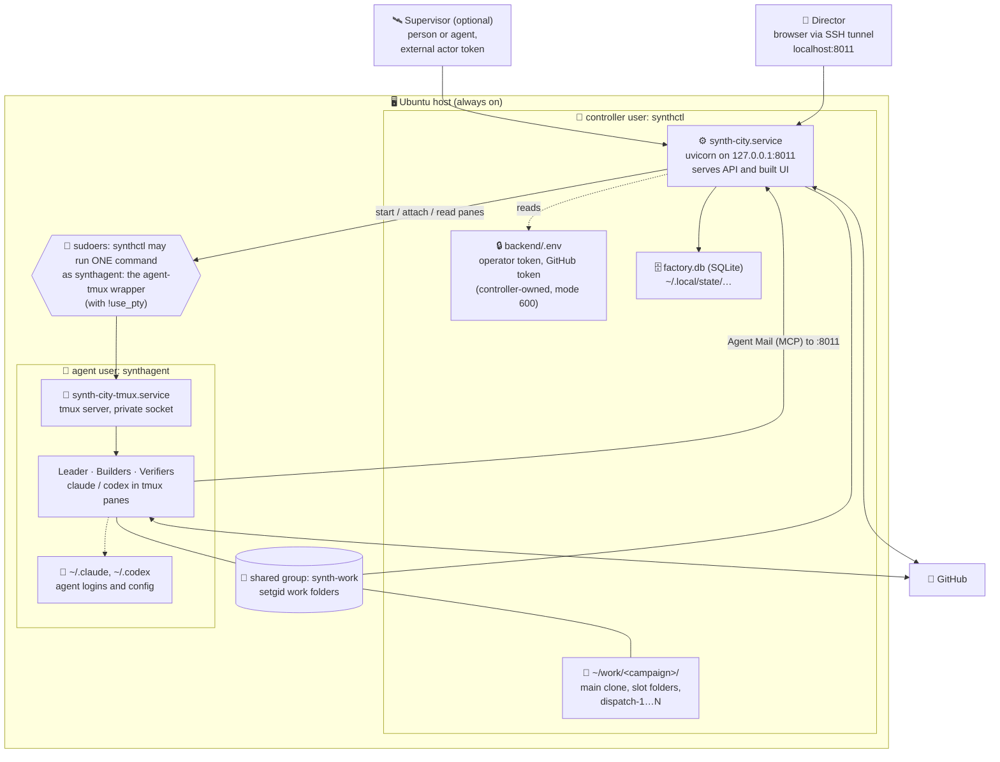
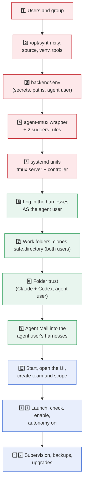
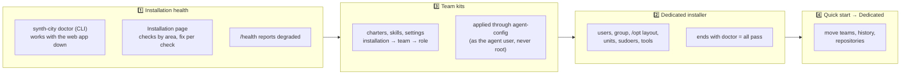

# 🏭 Guide 2 — Albiex Synth City as a dedicated factory

> [!NOTE]
> **Status: current situation, 22 Nov 2026 (Synth City 4.3.0, 4.4 in preparation).** There is **no installer for a dedicated factory today**. The reference factory, which builds Synth City itself, was set up by hand between October and November 2026. This guide describes that layout, the manual steps, the problems we hit, and the 4.5 ideas. It is a thinking aid for planning 4.5, and a map for anyone who wants to try it now on Ubuntu with **Claude Code** and **Codex**.
> **New to Synth City? Start with Guide 1 (single user).** Move up when you need unattended teams. **Guide 3 — operating the factory** covers what to configure once either setup is installed.

---

## 1. Why a dedicated factory?

| Problem in single-user mode | How the dedicated layout solves it |
|---|---|
| Agents can read your secrets (`backend/.env`, your SSH keys, your browser) | Agents run as a **separate agent user** with no access to the controller's files |
| Everything stops when you log out or reboot | **systemd** services start at boot and restart on failure |
| An agent can stop Synth City or other agents by accident | Processes belong to different users; a wrapper refuses `tmux kill-server` on the live sessions |
| Agents use your personal Claude and Codex configuration | Agents have their **own home**, logins and configuration, managed for the factory |

---

## 2. The big picture



> [!NOTE]
> The names `synthctl`, `synthagent`, `synth-work` and `/opt/synth-city` are **suggested names**. The reference factory still uses names from before the rename (`deckproductctl`, `deckproduct`, `deckproduct-work`, `/opt/claude-deck-product`). The checked-in examples in `scripts/product-factory/` use a third set (`/opt/albiex-synth-city-product`). This drift is one of the problems 4.5 must fix.

### What lives where

```text
/opt/synth-city/                     root-owned, read-only for both users
├── controller/                      Synth City source at a release tag (frontend built)
├── venv/                            Python environment for the controller
├── tools/                           pinned binaries: node, npm, claude, codex
├── agent-bin/                       wrappers on the AGENT user's PATH (e.g. per-slot model choice)
├── bin/tmux                         on the CONTROLLER's PATH: calls sudo → agent-tmux
├── libexec/agent-tmux               pins every tmux call to the live agent socket, cleans the env,
│                                    refuses kill-server
└── state/maintenance/               backups and rollback copies for upgrades

/home/synthctl/                      controller user
├── .local/state/synth-city/factory.db
└── work/                            group synth-work, setgid
    ├── operations/HOLD.json         emergency stop file (if present, dispatch holds)
    └── <campaign>/
        ├── main/                    the primary clone of the watched repository
        ├── leader/ build-1/ … review/   one folder per team slot
        └── dispatch-1/ … dispatch-N/    one worktree per item running at once

/home/synthagent/                    agent user
├── .claude.json, .claude/           Claude Code login, trust, Agent Mail MCP and hooks
├── .codex/config.toml, hooks.json   Codex login, folder trust, Agent Mail MCP and hooks
└── .local/state/synth-city/tmux.sock
```

---

## 3. The steps today (all manual)



🟥 needs `sudo` · 🟩 as the agent user (or both users) · 🟦 in the Synth City UI or API

<details>
<summary><b>1️⃣ Users and group</b></summary>

```bash
sudo adduser --disabled-password --gecos "" synthctl
sudo adduser --disabled-password --gecos "" synthagent
sudo groupadd synth-work
sudo usermod -aG synth-work synthctl
sudo usermod -aG synth-work synthagent
sudo install -d -o synthctl -g synth-work -m 2770 /home/synthctl/work
sudo chmod o-rwx /home/synthagent
```
Neither user needs a password or a login shell for daily use. You work through the browser, and `sudo -iu synthagent` when you must.
</details>

<details>
<summary><b>2️⃣ /opt/synth-city: source, Python environment, tools</b></summary>

```bash
sudo install -d -m 755 /opt/synth-city/{tools,agent-bin,bin,libexec,state}
sudo git clone https://github.com/albiexai/synth-city.git /opt/synth-city/controller
cd /opt/synth-city/controller && sudo git checkout v4.3.0
sudo python3 -m venv /opt/synth-city/venv
sudo /opt/synth-city/venv/bin/pip install -r backend/requirements.txt
(cd frontend && sudo npm ci && sudo npm run build)   # the backend serves frontend/dist
```
Put **pinned** copies of `node`, `npm`, `claude` and `codex` in `/opt/synth-city/tools`, so an update in someone's home folder never changes the factory. Upgrade them on purpose, with a backup copy of the old binary.
</details>

<details>
<summary><b>3️⃣ backend/.env</b> (names only; never paste values into issues or chats)</summary>

| Setting | Why |
|---|---|
| `OPERATOR_TOKEN` | Protects roster, scope, autonomy and recovery actions. `openssl rand -hex 32`. |
| `GITHUB_TOKEN` | Polling issues, PRs and checks. |
| `DATABASE_URL` | Points to the state folder (the default is relative to the working folder). |
| `HOST`, `PORT` | `127.0.0.1` and `8011`. Never expose the port on the network; use an SSH tunnel. |
| `HARNESS_AGENT_USER=synthagent` | The Harnesses pages then show the **agent's** configuration as "global", not the controller's. |
| `MAIL_CAPABILITY_TOKENS_REQUIRED=true` | Agents must present their session token for Mail writes (Linux only). |
| `GITHUB_COORDINATION_HOLD_PATHS` | Where the emergency stop file lives (`…/operations/HOLD.json`). |

`sudo chown synthctl:synthctl backend/.env && sudo chmod 600 backend/.env`. The agents must **never** see these values. Do not export them into any shell that starts `tmux`; tmux copies its environment to every pane.
</details>

<details>
<summary><b>4️⃣ The agent-tmux wrapper and two sudoers rules</b></summary>

The controller never runs `tmux` directly. `/opt/synth-city/bin/tmux` (first on the controller's PATH) runs:
```sh
exec /usr/bin/sudo -n -u synthagent /opt/synth-city/libexec/agent-tmux "$@"
```
`libexec/agent-tmux` (Python, see `scripts/product-factory/agent-tmux`) pins every call to the live socket, gives panes a clean environment, and refuses `kill-server`.

```text
# /etc/sudoers.d/synth-city   (edit with: sudo visudo -f /etc/sudoers.d/synth-city)
synthctl ALL=(synthagent) NOPASSWD: /opt/synth-city/libexec/agent-tmux
Defaults!/opt/synth-city/libexec/agent-tmux !use_pty
```
The second line is required for attaching to panes from the browser. Synth City never edits `sudoers` itself.
</details>

<details>
<summary><b>5️⃣ systemd units</b></summary>

`synth-city-tmux.service`: the tmux server, as the agent user.
```ini
[Service]
User=synthagent
Group=synthagent
SupplementaryGroups=synth-work
Environment=HOME=/home/synthagent
Environment=PATH=/opt/synth-city/agent-bin:/opt/synth-city/tools:/usr/bin:/bin
ExecStart=/usr/bin/tmux -D -S /home/synthagent/.local/state/synth-city/tmux.sock
Restart=on-failure
```
`synth-city.service`: the controller.
```ini
[Unit]
Requires=synth-city-tmux.service
After=network.target synth-city-tmux.service
[Service]
User=synthctl
Group=synthctl
SupplementaryGroups=synth-work
WorkingDirectory=/opt/synth-city/controller/backend
Environment=PATH=/opt/synth-city/bin:/opt/synth-city/tools:/usr/local/bin:/usr/bin:/bin
Environment=SYNTH_CITY_URL=http://127.0.0.1:8011
ExecStart=/opt/synth-city/venv/bin/python -m uvicorn app.main:app --host 127.0.0.1 --port 8011
AmbientCapabilities=CAP_SYS_PTRACE CAP_DAC_READ_SEARCH
UMask=0007
Restart=on-failure
```
The two capabilities let the controller find which pane an agent runs in, and read the agents' activity logs, **without** being root.
</details>

<details>
<summary><b>6️⃣ Log in the harnesses as the agent user</b></summary>

```bash
sudo -iu synthagent
claude            # log in, then /exit
codex login
exit
```
Check with **one real model call** as the agent user. A status command only reads saved state. Codex logins expire: put the expiry date in your calendar.
</details>

<details>
<summary><b>7️⃣ Work folders, clones and safe.directory</b></summary>

```bash
sudo -u synthagent git clone https://github.com/<owner>/<repo>.git /home/synthctl/work/<campaign>/main
for d in leader build-1 build-2 review dispatch-1 dispatch-2; do
  sudo -u synthagent git -C /home/synthctl/work/<campaign>/main worktree add --detach ../$d origin/<base>
done
# git refuses folders owned by another user: add EVERY folder for BOTH users
for u in synthctl synthagent; do for d in main leader build-1 build-2 review dispatch-1 dispatch-2; do
  sudo -u $u -H git config --global --add safe.directory /home/synthctl/work/<campaign>/$d
done; done
```
</details>

<details>
<summary><b>8️⃣ Folder trust for Claude Code and Codex (as the agent user)</b></summary>

Synth City prepares trust for a team's folders at launch. Folders added later (a new slot, more dispatch workspaces) needed it by hand in v4.3:
- **Codex**: a `[projects."<folder>"] trust_level = "trusted"` entry per folder in `~synthagent/.codex/config.toml`. A missing entry fails the launch with "Workspace trust could not be prepared".
- **Claude Code**: `hasTrustDialogAccepted: true` per folder in `~synthagent/.claude.json`. Edit only when no Claude session of that user is running.
</details>

<details>
<summary><b>9️⃣ Agent Mail into the agent user's harnesses</b></summary>

The Agent Mail **Install** tab writes to the controller's own home. For a dedicated factory, today you apply the same MCP and hook configuration **in the agent user's** `~/.claude` and `~/.codex`, by hand. **After every upgrade, check that all hooks are present.** A missing new hook once blocked every Claude Code member.
</details>

<details>
<summary><b>🔟–1️⃣2️⃣ Start, team, launch, run</b></summary>

```bash
sudo systemctl daemon-reload
sudo systemctl enable --now synth-city-tmux synth-city
ssh -L 8011:127.0.0.1:8011 <host>      # from your laptop; open http://localhost:8011
```
1. **Teams**: create the team (Leader, builders with area labels, at least one `verifier`), one slot per folder from step 7.
2. **Repositories**: add the scope **disabled**: repository, main clone, base branch, labels (ready, design, review hold), merge policy, limits. Register the dispatch workspaces.
3. **Launch** the team. Restart each Codex member once in resume mode so it is **observed**.
4. Check every member: Mail identity (`synth_city_whoami`), one tool call, trust, the right folder.
5. **Activation readiness** for the scope must be clear. Then enable the scope, check that `last_polled_at` advances, and turn autonomy on at low concurrency.
6. Back up `factory.db` before every upgrade. Upgrade at a quiet point: autonomy off, nothing dispatched, back up, switch to the new tag, rebuild, restart, re-check hooks and readiness, autonomy on.
</details>

---

## 4. Where things stand (dedicated)

| Area | Today | Notes |
|---|---|---|
| Installer | ❌ None | All 12 steps by hand. About half a day to a day for someone who knows Linux. |
| Example files | 🟡 In `scripts/product-factory/` | Units, wrappers and `productctl` from the reference factory, with **hard-coded paths and names that have drifted**. Read them; don't copy them unchanged. |
| Product runs fine once set up | ✅ Yes | Three release campaigns (4.1, 4.2, 4.3) ran on the reference factory with 4–5 agents. |
| Cross-user features | ✅ Built | Pane binding, activity reading, Harnesses for the agent user (`HARNESS_AGENT_USER`), the terminal attach. |
| Agent Mail for the agent user | 🟡 By hand | No supported way for the controller to write the agent user's config. |
| New slot or workspace | 🟡 By hand | `safe.directory`, trust and PATH per folder. Being fixed in **4.4** (#948, #1262). |
| Health check | ❌ None | Problems are found by operators, not by the product. |
| Secrets | ✅ Out of agents' reach | As long as nothing exports them into tmux. |
| Upgrades | 🟡 Scripted privately | Backup, rollback copy and a checkpoint upgrade pattern; not in the product. |
| Supervisor tooling | 🟡 Private scripts | A supported kit is planned in **4.4** (#1116). |

### What went wrong on the reference factory (lessons for the installer)

| Symptom | Cause | Prevention we want |
|---|---|---|
| `fatal: detected dubious ownership` | A folder owned by the other user | Installer and slot setup add `safe.directory` for both users |
| Codex launch: "Workspace trust could not be prepared" | No trust entry for a new folder | Automatic trust on slot and workspace creation (#1262) |
| `npm: command not found` in an agent pane | The tools folder was not on the agent's PATH | PATH set by the launch, checked by the doctor |
| Codex member "activity unknown" | Launched fresh, never resumed | Observable first launch (#1262) |
| Every Claude Code member blocked after an upgrade | A new Agent Mail hook was not installed in the agent user's config | The `agent-config` helper and a hook check |
| Harnesses page showed the controller's skills, not the agents' | The agent user was not configured | `HARNESS_AGENT_USER`, checked by the doctor |
| A test killed every agent session | `tmux kill-server` reached the live socket | The `agent-tmux` wrapper refuses it |
| Secrets readable from any pane | The token was exported into tmux's global environment | Never export; keep it only in `backend/.env`; the doctor checks |
| Factory quietly idle after a reboot | A guard stop had disabled the scope | Re-enable the scope as well as autonomy; check `last_polled_at` |
| Agent stuck for hours | It asked a question with an interactive tool | Claude Code hook blocks it for team members; charters say "never" |

---

## 5. Ideas for 4.5 (the installation programme)

> [!NOTE]
> Decided in outline by the Director on 16 Nov 2026. Design draft for project 1 in PR #978. Order: **1 → 3 → 2 → 4**. Nothing below is built yet.



| Check area (doctor) | Examples |
|---|---|
| **Layout** | Users and group exist; work folders have the right owner, group and setgid; Python, Node, git and tmux versions |
| **Permissions** | Exactly the two command-scoped sudoers rules; the controller reaches the agent socket; capabilities and `ptrace_scope` allow cross-user reads |
| **Services** | Units active and enabled; database writable; free disk; a recent backup |
| **Secrets** | Operator token present, mode 600, right owner; **not** in tmux's environment |
| **Git and GitHub** | `safe.directory` for each folder and both users; GitHub auth; base branch exists; CI triggers on it |
| **Each harness** | Binary and version; login valid (Codex expiry); Agent Mail MCP and **all** hooks current; folder trust; question tools blocked |
| **Teams** | Each slot's folder exists and is trusted; members registered; scope readiness; supervisor checked in |

**Fix rule:** one click only for what Synth City owns (for example, repair Agent Mail as the agent user through the `agent-config` helper). For anything that changes the security boundary (users, sudoers, units, capabilities), the page shows the **exact command to copy** and re-checks afterwards. The web app never gains a route to root.

### Decisions for the 4.5 campaign (Director, 2026-11-24)

These are recorded in the installation design (PR #978, sections E–M) and on #979.

| Question | Decision | Why |
|---|---|---|
| **Installer shape** | A Python command, `synth-city install --dedicated`. It shows a plan first, runs with `--execute`, is safe to run again, and runs each root step on its own through `sudo` with the command printed. It is tested in CI with real `sudo`. | It shares the layout file and checks with `synth-city doctor`: installing is "fix until the doctor passes". Shell scripts drifted; a `.deb` costs too much while the installer changes. |
| **Source** | A **release archive** attached to each GitHub release: source, built UI, locked requirements, checksum. `git clone` stays for Quick start and development. | No Node is needed on the host for Synth City itself, and each version unpacks into its own folder. |
| **Names and paths** | `synthctl`, `synthagent`, `synth-work`; `/opt/synth-city/releases/<version>` with a `current` link; `/etc/synth-city/layout.toml` and `/etc/synth-city/env`; state in `/var/lib/synth-city/`. Units are generated from the layout file. | One source of truth. An existing factory adopts a layout file with its current names, so nothing needs renaming. |
| **The `agent-config` sudoers rule** | **Confirmed.** One helper, run as the agent user. It takes one typed request on standard input and writes only an allowlist of config entries (trust, MCP, hooks), with a backup. A minimal version (folder trust only) ships in **4.4** with #1262. | Group-write on the agents' files breaks, and a root helper widens the boundary. Missing hooks once blocked every Claude Code member. |
| **Harness logins** | A **guided step**: the installer shows the exact login commands for the agent user, then **verifies** each harness with one real model call. The doctor warns before the Codex login expires. | The installer can't log in for you, and must never copy your credentials. |
| **Remote access** | An **SSH tunnel** by default; **`tailscale serve`** documented; **no public reverse proxy** for now. The doctor warns if the backend listens beyond `127.0.0.1`. | Reads aren't authenticated, and live sessions can attach to agent terminals: exposing the port is close to a remote shell. |
| **Several teams** | **One shared agent user** in the first version. The layout file maps team → agent user from the start. | A harness login belongs to an OS user: teams on different subscriptions or owners need their own agent user later. |
| **Upgrades** | **Part of the installer project**: `synth-city upgrade <version>` (preflight with nothing dispatched, backup, unpack, migrate, switch `current`, restart, re-apply hooks, doctor) and `synth-city rollback`. A new operation that reuses parts of `scripts/factory-maintenance.py` (which stays for mid-campaign fixes). | An install is the first upgrade; both use the same layout and checks. |
| **Ubuntu versions** | **24.04 LTS and 26.04 LTS**, including **WSL 2** (the doctor checks that systemd is on, and warns that a WSL shutdown stops the factory). 22.04 for Quick start only. | The reference factory runs on WSL 2. |
