# 🎛️ Guide 3 — Operating the factory: what to configure after installing

> [!NOTE]
> **Status: current situation, 22 Nov 2026 (Synth City 4.3.0; 4.4 is in preparation).** This guide is for the **operator / Director**: the person who decides what the factory works on, with which agents, under which rules. It begins right after **Guide 1** (single user) or **Guide 2** (dedicated factory), and applies to both. Every parameter below is the real field name, with its default and an example from the Synth City 4.4 team.

---

## 🧠 Before the settings: how the factory thinks

Most settings in this guide make sense once you know **three ideas**. If a setting seems strange later, come back here.

| # | Idea | In plain words | The settings it explains |
|---|---|---|---|
| 1 | **Agree before you build** | A builder writes a **plan** first: which files it will change, which commands it will run, how long it will take. The Leader approves it. The approved plan becomes the **agreed scope** of the work. Who checks it depends on the stage: for the first plan, **the verifier** checks in review that the PR stayed inside it; for a continuation, **Synth City itself** refuses any changed file that isn't on the approved list. | Leader, plan approval, ack windows, approval rounds, amendments, continuation |
| 2 | **Trust the checks, not the agent** | An agent saying "done, tests pass" proves nothing. A PR merges only when **CI is green** and a **different agent (a verifier) accepted that exact commit**. | Verifier role, review hold label, required checks, merge policy |
| 3 | **Every attempt has a budget** | Agents don't get tired and don't give up. Without limits, a stuck item can loop for hours and burn your quota. Each kind of retry has a counter, and when one runs out the item **stops and asks for a human or the Supervisor**. | Rounds, retries, effort limit, continuation limits, daily merge cap |

### One issue's journey, with the vocabulary

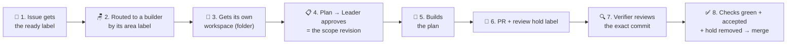

Here is the same journey from the 4.4 campaign, with **who does each action** spelled out. Nothing here is magic: every action is done either by a **person**, by **an agent using a tool**, by the **Synth City backend** (a program running on the factory), or by **GitHub** itself.

| Icon | Actor | What it is |
|---|---|---|
| 🧑 | **Supervisor / Director** | A person, or an agent acting as Supervisor. Works on GitHub and in the Synth City UI. |
| ⚙️ | **Synth City backend** | The server process. Its **watcher** loop runs every 60 seconds: it reads GitHub, updates its database, prepares folders and sends messages. It never writes code. |
| 🧭 🔨 🔍 | **Leader, builder, verifier** | Claude Code or Codex sessions in `tmux`. They act through `git`, `gh` (the GitHub CLI) and **Agent Mail tools** (`synth_city_*`). |
| 🐙 | **GitHub** | Runs CI (GitHub Actions) and closes issues from PR descriptions. |

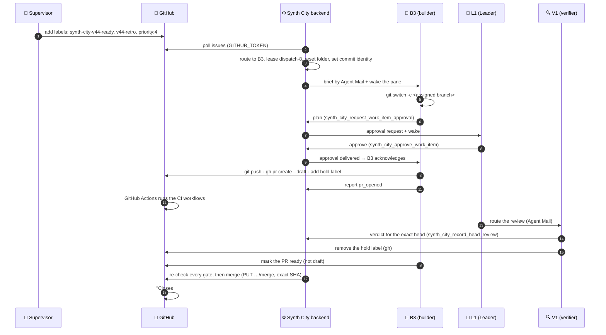

**Step by step:**

1. 🧑 **The Supervisor adds labels** to issue #1240 on GitHub: `synth-city-v44-ready`, `v44-retro`, `priority:4`. (Web page, or `gh issue edit 1240 --add-label …`.)
2. ⚙️ **The backend's watcher reads the issue** on its next poll, using `GITHUB_TOKEN`. It finds the first enabled builder whose `area_labels` include `v44-retro`: **B3**. It records a **work item** for #1240 in its database, with status `pending`.
3. ⚙️ **The backend prepares a workspace** as soon as B3 is free and a registered folder is free:
   - It **leases** `dispatch-8`: it records in its database that this folder now belongs to #1240.
   - It **resets** the folder to the base branch: `git fetch`, `git switch --detach --force origin/release/v4.4`, `git reset --hard`, `git clean -fd`.
   - It writes **B3's commit identity** into that folder's git config (`B3 Claude Opus 5.5 builder (retrospectives) (Synth City agent)`, `…+slot40@synth-city.local`), so the commits show which slot made them.
   - It **chooses the branch name** (`deck/slot-40/issue-1240-<random>`) and writes the **brief**: the issue, the folder, the branch, the rules.
   - It **delivers the brief** by Agent Mail and **wakes** B3: it types a short prompt into B3's `tmux` pane.

   *And the folder itself?* It was created **when the operator registered it** (`POST …/workspaces`): if the folder didn't exist, the backend ran `git worktree add --detach <folder> origin/release/v4.4` from the main clone. If it already existed (as in 4.4, where the Supervisor created the folders by hand), the backend **adopted** it after checking that it's a worktree of the same repository.
4. 🔨 **B3 creates its branch** (`git switch -c <assigned name>`), reads the issue, and **writes a plan**. It sends it with the Agent Mail tool `synth_city_request_work_item_approval`. ⚙️ The backend records the request, starts the Leader's clock (section 5) and wakes the Leader. 🧭 **L1 approves** with `synth_city_approve_work_item`. ⚙️ The backend records the approval as **scope revision 0** and delivers it; 🔨 B3 acknowledges it before editing.
5. 🔨 **B3 builds**: it edits files, runs the focused tests, commits and pushes with `git`. Nothing stops it from touching other files at this point: for a first plan, staying inside the plan is **checked by the verifier** in step 7. (Synth City compares files automatically only for continuation revisions; see section 7.)
6. 🔨 **B3 opens a draft PR** with `gh pr create --draft`, adds the `synth-city-v44-review-hold` label, and reports `pr_opened` with the PR number. (With a GitHub App, B3 reports `pr_ready` instead, and ⚙️ the **backend opens the draft PR** as the App's bot, titled `[B3 …] <issue title> (#1240)`, with `Closes #1240` in its description.) 🐙 **GitHub Actions runs the CI workflows** on the PR.
7. 🧭 **L1 sends the review** to V1 by Agent Mail, and wakes it as soon as the checks finish. 🔍 **V1 reviews commit `a1b2c3d`**, the exact head, in its own review folder: the acceptance items, the tests, and that the changes **stay inside the issue and the approved plan**. It records `accepted` with `synth_city_record_head_review` and **removes the hold label** with `gh`. If B3 pushes again, V1 must review the new commit. 🔨 B3 then **marks the PR ready** (not draft) at the same commit.
8. ⚙️ **The backend merges.** On its next poll it re-reads the PR and checks every gate: the **five required checks** are green, V1's acceptance is for the current head, the Leader's approval is current, the PR is not a draft, and the hold is gone. Then it calls GitHub's merge API itself, with the exact commit it checked (if anything was pushed in between, GitHub refuses). **No agent issues the merge.** GitHub records the merge under **the account that owns the backend's token** (section 4b). One of today's 80 automatic merges is used.

   | Required check | Workflow | What it runs |
   |---|---|---|
   | `Full backend regression tests` | `backend-tests.yml` | A **gate** job: green only when all 4 parallel shards of the backend test suite (pytest) pass |
   | `Product CI gate` | `product-ci.yml` | A gate job over the frontend tests and production build |
   | `e2e` | `e2e.yml` | Browser end-to-end journeys (Playwright) against an isolated instance |
   | `Changed Python undefined names` | `factory-checks.yml` | `ruff` on the Python files the PR changed, for undefined names |
   | `Rename old-name guard` | `factory-checks.yml` | `scripts/ci/old_names.py`: no old product names outside the history folders |

   *Gate jobs* exist so that the delivery policy can name **one** check for a group of jobs: if the suite is split into 4 shards tomorrow, the policy doesn't change. Other jobs (CodeQL, `Hosted real-sudo attach`, …) still run but **don't block** the merge, because they aren't listed.
9. **Closing the issue** depends on the mode. With a **GitHub App**, the backend wrote `Closes #1240` into the PR description, so 🐙 **GitHub closes the issue** at merge. In **ambient** mode (the Synth City factory today), the builder's PR description usually doesn't say it, so nothing closes the issue automatically: 🧑 **the Supervisor closes it**, after checking that the work item is `merged` (never before: an issue whose work item isn't finished must stay open). ⚙️ The backend marks the work item `merged`, and the folder's **lease is released**. The next item that gets `dispatch-8` starts with a fresh reset (step 3).

**When something goes wrong**, the budgets take over:

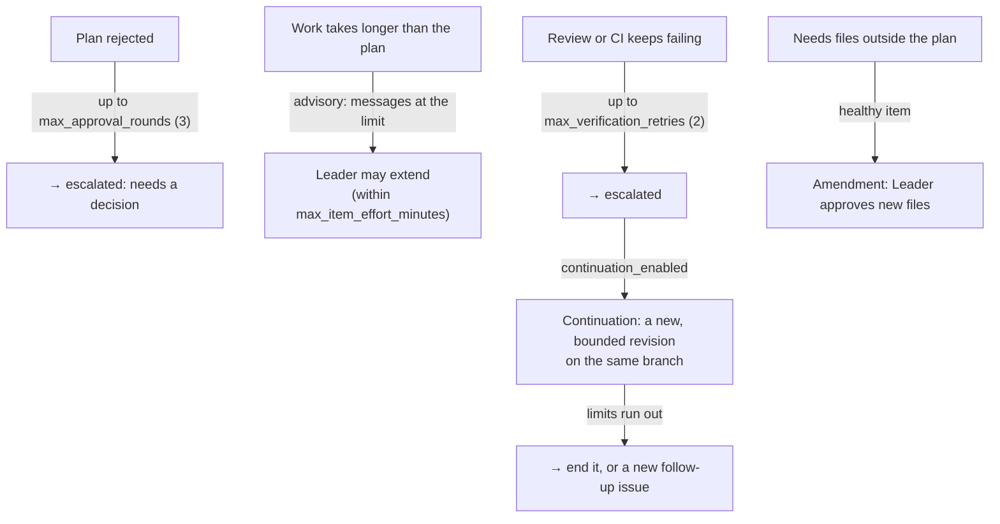

---

## 1. The map: what you configure

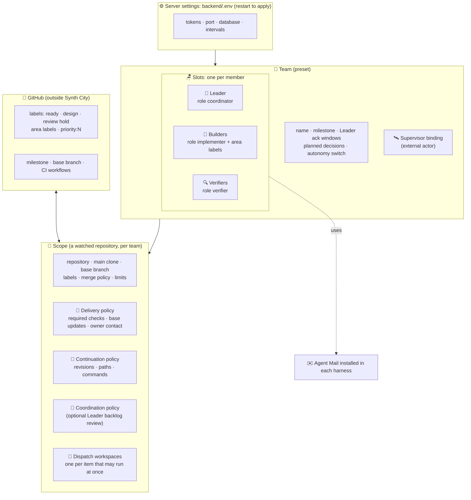

| Layer | Where you change it | How often | Who may change it |
|---|---|---|---|
| ⚙️ Server settings | `backend/.env`, then restart | Once, at install | Whoever administers the host |
| 🐙 GitHub labels, milestone, branch, CI | GitHub | Once per campaign | Repository maintainers |
| 👥 Team and 🪑 slots | **Teams** page, or `/api/v1/agent-teams/presets…` | Once per campaign; slots when the roster changes | Operator (needs the operator token) |
| 📂 Scope | **Repositories** page (guided setup), or `/api/v1/agent-teams/github-scopes…` | Once per campaign, adjusted mid-campaign | Operator |
| 📜 Delivery policy, supervisor binding, hold label, effort limit | **API only today** (UI coming in 4.4, #1115) | Rarely | Operator |
| ▶️ Autonomy | **Teams** page | Every start and stop | Operator |

> [!IMPORTANT]
> **The operator token** (`OPERATOR_TOKEN` in `backend/.env`) protects every change to teams, scopes, autonomy and recovery. The UI asks for it once per browser tab. API calls send it as the header `X-Synth-City-Operator-Token`. Never paste it into Agent Mail, an issue or a chat.

> [!TIP]
> **💡 Why a token at all, when it's your own machine?** The agents can call Synth City's API too: that's how Agent Mail works. Without a token, any agent could switch its own team's autonomy on, change its limits, or approve its own work. The token marks a change as **the operator's**, not an agent's. In single-user mode this protection is weaker, because agents run as you and could read the file. That's one reason for a dedicated factory.

---

## 2. Day one, in order

```mermaid
flowchart LR
    A["1️⃣ Server settings<br/>tokens, restart"] --> B["2️⃣ GitHub<br/>labels, branch, CI"]
    B --> C["3️⃣ Agent Mail<br/>install per harness"]
    C --> D["4️⃣ Team<br/>+ slots + Leader"]
    D --> E["5️⃣ Scope<br/>disabled at first"]
    E --> F["6️⃣ Policies<br/>delivery, continuation"]
    F --> G["7️⃣ Workspaces"]
    G --> H["8️⃣ Launch team<br/>check members"]
    H --> I["9️⃣ Readiness clear<br/>→ enable scope"]
    I --> J["🔟 Autonomy on<br/>low concurrency"]
    J --> K["➕ Ready labels<br/>on issues"]
```

---

## 3. Server settings (`backend/.env`)

Nothing here is needed to **start** Synth City. These matter when you run teams and autonomy. Names are case-insensitive (`operator_token` = `OPERATOR_TOKEN`).

| Setting | Default | Example | What it decides |
|---|---|---|---|
| `OPERATOR_TOKEN` | *(empty)* | `openssl rand -hex 32` | Protects all operator changes. **Set it.** |
| `GITHUB_TOKEN` | *(empty)* | a token with repo access | Polling issues, PRs and checks. Required for autonomy. |
| `GITHUB_APP_ID`, `GITHUB_APP_PRIVATE_KEY_PATH`, `GITHUB_APP_BOT_LOGIN` | *(empty)* | — | Optional: dispatch as a GitHub App bot instead of your login. |
| `HOST`, `PORT` | `127.0.0.1`, `8000` | `127.0.0.1`, `8011` | Where the backend listens. Keep it on localhost. |
| `DATABASE_URL` | `sqlite+aiosqlite:///./synth_city.db` | a path in the state folder | Relative to the working folder; use an absolute path on a factory. |
| `HARNESS_AGENT_USER` | *(none)* | `synthagent` | Dedicated only: whose `~/.claude` the Harnesses pages show as "global". |
| `MAIL_CAPABILITY_TOKENS_REQUIRED` | `true` | `true` | Agents prove their session for Mail writes (Linux). |
| `GITHUB_DISPATCH_INTERVAL_SECONDS` | `60` | `60` | How often the watcher polls GitHub. |
| `GITHUB_MIN_AVAILABLE_MEMORY_MB` | `3000` | `3000` | Dispatch pauses when free memory is below this. |
| `GITHUB_LEADER_ACK_TIMEOUT_SECONDS` / `…_MAX_WAIT_SECONDS` | `300` / `1800` | — | Default time for the Leader to answer a plan (the team can override). |
| `GITHUB_OWNER_IDLE_TIMEOUT_SECONDS` | `900` | — | When an idle builder is nudged. |
| `MAIL_REQUEST_UNANSWERED_SECONDS` | `1200` | — | When an unanswered Mail request counts as stalled. |
| `GITHUB_COORDINATION_HOLD_PATHS` | *(none)* | `…/operations/HOLD.json` | Emergency stop: while this file exists, dispatch holds. |
| `GITHUB_PUBLISH_SUMMARIES_ENABLED` | `false` | `true` | Synth City posts its own work summaries on issues and PRs. |

> [!TIP]
> **💡 Why so many timers?** An agent can't tell you it's stuck: it simply stops talking. Synth City notices **silence** instead. Each timer means "after this long without news, do something": nudge the builder, remind the Leader, tell the Supervisor, or escalate. The defaults come from three release campaigns. Change them only after you've seen a real problem; the retrospectives coming in 4.4 will show where time is lost.
>
> **🧪 Example:** B2 has been silent for 15 minutes (`GITHUB_OWNER_IDLE_TIMEOUT_SECONDS` = 900). Synth City sends it a nudge in its pane. If it still doesn't answer, the item is reported as stalled and the Supervisor sees it at its next check-in.

<details>
<summary>More timing and nudge settings (rarely changed)</summary>

`GITHUB_CHECK_SIGNAL_GRACE_SECONDS` (120) · `GITHUB_OWNER_REGISTRATION_GRACE_SECONDS` (120) · `GITHUB_DESIGN_ACK_MULTIPLIER` (3) · `GITHUB_TEAM_IDLE_TIMEOUT_SECONDS` (1800) · `WAKE_FOLLOWUP_ENABLED` (true) / `WAKE_FOLLOWUP_DELAY_SECONDS` (120) · `GITHUB_NUDGE_GRACE_SECONDS` (180) · `GITHUB_STALE_LEASE_BACKSTOP_SECONDS` (21600) · `GITHUB_BRIEF_DELIVERY_MAX_NUDGES` (2) · `GITHUB_CONTINUATION_PROPOSAL_EXPIRY_SECONDS` (3600) · the `…_NUDGE_COOLDOWN_SECONDS` settings (180) · `BRIDGE_ATTACHMENT_*` (image paste into sessions: folder, 10 MB, 7 days, 100 per day).
</details>

---

## 4. GitHub: the factory reads labels, not minds

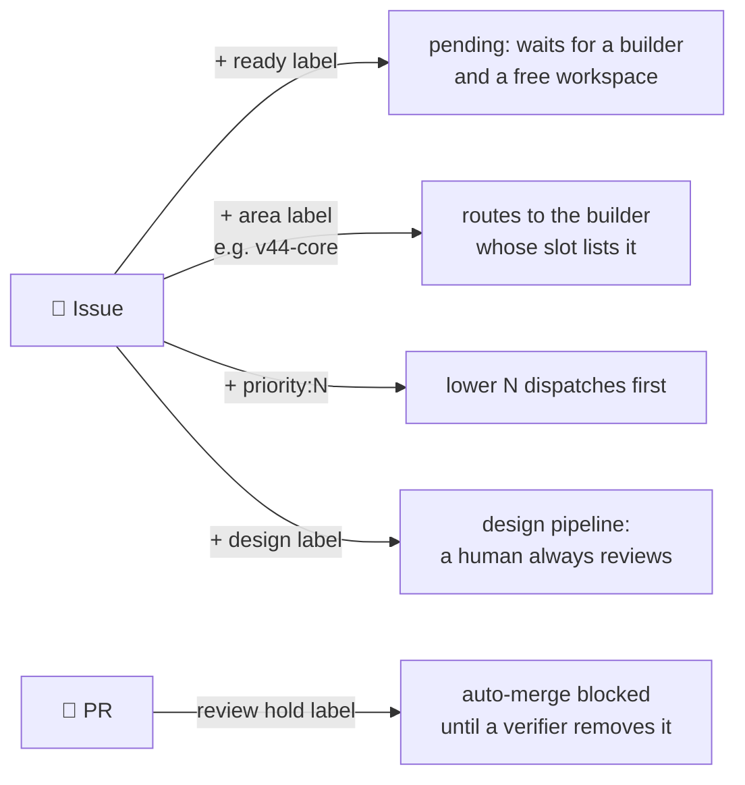

| GitHub item | Example (4.4) | Effect |
|---|---|---|
| **Ready label** (`dispatch_label`) | `synth-city-v44-ready` | Adding it queues the issue. Removing it **during** an attempt escalates the attempt. |
| **Design label** (`design_label`) | `synth-city-v44-design` | The issue produces a design PR; design PRs always need a human. |
| **Review hold label** (`review_hold_label`) | `synth-city-v44-review-hold` | While on the PR or issue, auto-merge waits. Builders add it; the accepting verifier removes it. |
| **Area labels** | `v44-core`, `v44-infra`, `v44-retro`, `v44-ui` | Routing: the first enabled builder (in roster order) whose `area_labels` include one of the issue's labels. Exact match, case-sensitive. No match = stays pending (`no_eligible_owner`). |
| **Priority labels** | `priority:1` … `priority:30` | Queue order: lowest first. |
| **Milestone** | `v4.4` | The team's `backlog_milestone`: campaign progress on Overview. |
| **Base branch** | `release/v4.4` | Where PRs go. **Its CI must run on PRs into that branch**, or no checks appear and nothing merges. |
| **CI checks** | the five in step 8 of the journey | Named in the delivery policy's `required_checks`. |

> [!TIP]
> **💡 Why labels, instead of a queue inside Synth City?** GitHub is the place that **you, the agents and other people all see**. A label is visible on the issue, has a history, and can be changed from your phone. Synth City only reads them. To steer the factory, you change labels: you never need to open Synth City to say "do this next".
>
> **🧪 Example (lanes):** in 4.4, issues about dispatch carry `v44-core` and go to B1; UI issues carry `v44-ui` and go to B4. Two builders never get issues about the same part of the code at the same time, so their PRs rarely collide. An issue with no lane label is never picked up: that's how the tracking issues stay out of the queue.

> [!TIP]
> One label per lane, and one priority per issue, give the Leader and the builders a clear queue. Never hold a queue by removing ready labels: that escalates items. Give an item a higher priority number instead, or turn autonomy off.

---

## 4b. Who is the GitHub user?

Every action on GitHub is done **as some account**. The factory has three kinds of actor, and you choose which account each one uses.

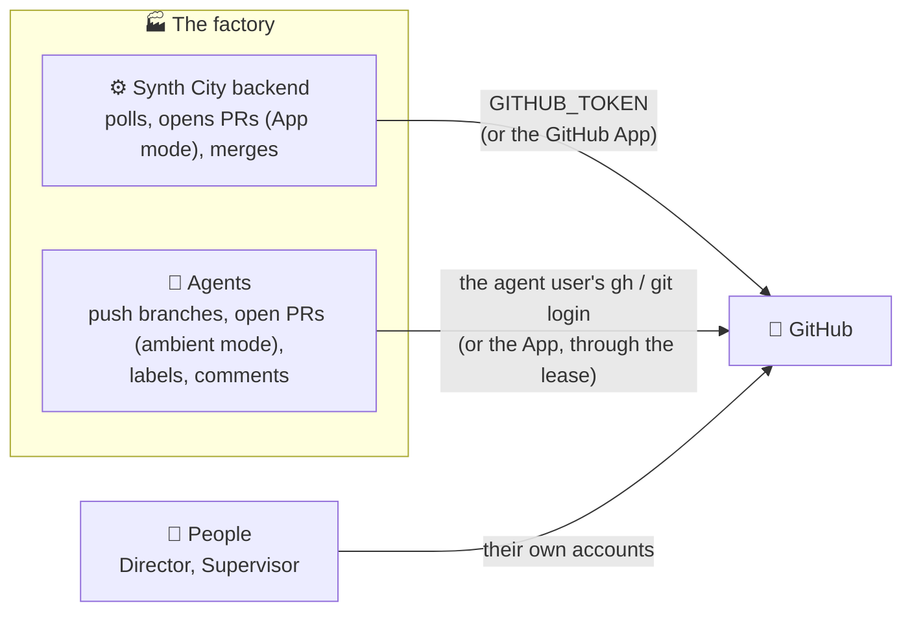

| GitHub action | Done by | As which account |
|---|---|---|
| Read issues, PRs, checks, CI logs | ⚙️ Backend | The owner of `GITHUB_TOKEN` |
| Push the branch | 🔨 Builder (`git push`) | **Ambient:** the agent user's own git/`gh` login. **App:** a short-lived App token, through a credential helper that works only while the builder holds the folder's lease |
| Open the draft PR | 🔨 Builder (ambient) / ⚙️ backend (App) | Ambient: the agent's login. App: the App's bot |
| Add or remove labels, comment | 🔨 Builder, 🔍 verifier (`gh`) | The agent user's `gh` login |
| Merge | ⚙️ Backend | The owner of the token the backend merges with |
| Commit author (inside the commits) | 🔨 Builder | **Not a GitHub account:** the slot identity the backend wrote, e.g. `B3 … (Synth City agent) <…+slot40@synth-city.local>` |

**What the Synth City factory does today:** `github_auth_mode: ambient`, with **one personal account** for everything the factory does. The backend's token and the agent user's `gh` login belong to the Director. In v4.3, 51 merges show that account (the factory's automatic merges), and 34 show the Supervisor's own account (its hand merges and recoveries). That works, but it has costs:
- **The agents can do anything that account can do**, on every repository it can reach, not only this one.
- A merge by the Director and a merge by the factory look **the same** on GitHub.
- If that token leaks, it's a personal token that leaked.

### Best practice, from good to best

| | 🥉 Your personal account | 🥈 A machine user | 🥇 A GitHub App |
|---|---|---|---|
| **What it is** | Your own login, for the agents and `GITHUB_TOKEN` | A **separate GitHub account** for the factory (for example `yourname-factory`), invited to the factory's repositories only | A GitHub App you create and install on the repositories; Synth City makes short-lived tokens from its private key |
| **Setup** | None | 10 minutes: new account, invite with **Write** (not Admin), a **fine-grained token** for those repositories | 30 minutes: create the App, download its key, install it; set `GITHUB_APP_ID`, `GITHUB_APP_PRIVATE_KEY_PATH`, `GITHUB_APP_BOT_LOGIN` |
| **Blast radius if misused** | Everything you can do | Only the factory's repositories | Only the installed repositories, and pushes only while a lease is held |
| **Who did what, on GitHub** | ❌ Can't tell you from the factory | ✅ The factory's account vs yours | ✅ The bot vs people |
| **Good for** | Trying Synth City on a test repository | **A first real factory (recommended start)** | A long-running factory, or several teams |

> [!TIP]
> **Recommendation:** use **a machine user** for a dedicated factory from day one. Give its fine-grained token only these permissions, on only the factory's repositories:
>
> | Permission | Access | Why |
> |---|---|---|
> | Contents | Read and write | Push branches, merge |
> | Pull requests | Read and write | Open PRs, mark ready, merge |
> | Issues | Read and write | Labels, comments |
> | Checks, Commit statuses, Actions | Read | Required checks, CI logs and queue times |
> | Metadata | Read | Required by GitHub |
>
> Log the agent user in as that account (`gh auth login`, as the agent user), and use a token of the same account for `GITHUB_TOKEN`. Keep your own account for your own work. **Never give the agents an Owner or Admin token**, and keep branch protection with required checks on `main`/`master` as a safety net, even though Synth City checks the gates itself.
>
> In App mode you still need `GITHUB_TOKEN` for polling (a machine user's read-only token is enough).

## 5. The team (preset)

| Field | Default | Example (4.4) | What it decides |
|---|---|---|---|
| `name` | — | `synth-city-v4.4` | Unique. One team per campaign is a good habit (duplicate the last one). |
| `description` | — | "the multi-team core and campaign retrospectives…" | Shown on Teams and to agents. |
| `backlog_milestone` | *(none)* | `v4.4` | Campaign progress counts on Overview. |
| `parent_issue_url` | *(none)* | a tracking issue URL | Alternative to a milestone for progress. |
| `planned_decisions` | *(none)* | up to 12 lines, each `later` / `now` / `done` | Decisions you plan to take during the campaign; shown to the Leader. |
| `leader_ack_timeout_seconds` | server default (300) | `300` | How long the Leader has to acknowledge a plan request (30–86 400). |
| `leader_ack_max_wait_seconds` | server default (1800) | `1800` | The hard limit before escalation (≥ the timeout). |
| **Leader** (`PUT …/presets/{id}/leader`) | *(none)* | slot L1 | Leader authority: approves plans, never owns an issue. Only while autonomy is off. |
| `autonomy_enabled` | `false` | `false` until launch | The master switch for dispatch. |

> [!TIP]
> **💡 Why a Leader, and why does it have a deadline?** Builders are good at doing, but not at judging scope: they tend to do too much or wander outside the issue. The Leader reads each plan **before any code is written**, when a correction is cheap ("drop the refactor, and add a test for the failure case"). It never builds, so it never approves its own work.
> The **ack windows** exist because a plan request blocks a builder: while the Leader is busy, the builder waits. After `leader_ack_timeout_seconds` (5 min) the Leader is reminded and the Supervisor is told. After `leader_ack_max_wait_seconds` (30 min) the request ends with `leader_ack_timeout`, so a busy or broken Leader can't hold builders forever.
>
> **🧪 Example:** the Leader is in the middle of a long analysis when B1 asks for approval. After 5 minutes it gets a reminder; it finishes its turn, approves, and B1 starts. If the Leader's session had crashed, the request would end at 30 minutes and the Supervisor would restart the Leader.

> [!TIP]
> **💡 Planned decisions** are your own to-do list for the campaign ("decide whether #1109 needs a second verifier", state `later`). The Leader sees them, so it doesn't ask you about something you've already planned to decide.

> [!NOTE]
> **Duplicate, don't rebuild.** `POST /presets/{id}/duplicate` copies every slot, its charter and launch options, and the Leader. Change what's new, and clear any copied `session_id` so each member starts a fresh conversation.

---

## 6. Slots: one per team member

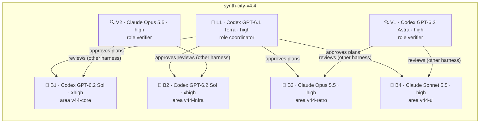

| Field | Default | Example | What it decides |
|---|---|---|---|
| `display_name` | — | `B1 GPT-6.2 Sol builder (core)` | Shown everywhere; name the role and model. |
| `provider` | `codex-cli` | `codex-cli` or `claude-code` | The harness (also `copilot-cli`, `opencode-cli`, `pi-cli`, …). |
| `role` | *(none)* | `coordinator` / `implementer` / `verifier` | `coordinator` is never routed work. Only `verifier` slots can accept a head for auto-merge. |
| `repo_path` | — | `…/work/v41/build-1` | The member's own folder. Its repository must match the scope's. |
| `area_labels` | *(none)* | `["v44-core"]` | Routing: which issues this builder takes. |
| `charter` | *(none)* | the member's rules, in plain sentences | **The most important field.** See below. |
| `bootstrap_prompt` | *(none)* | "Read your charter, then the v4.4 issues: …" | First message at launch. |
| `launch_mode` | `plain` | `plain` → later `resume` | `plain` starts fresh; `resume` continues `launch_options.session_id`. Codex: `fork` too. |
| `launch_options` | `{}` | see the next table | CLI flags for the harness. |
| `controlled_language_enabled` | `true` | `true` | Asks the agent to write short ASD-STE100 sentences. |
| `expertise` | *(none)* | — | Stored; **does not route work yet** (4.4: #1109). |
| `enabled` | `true` | `true` | A disabled slot gets no work and can't accept reviews. |
| `ui_color`, `position` | — | — | Display only. |

> [!TIP]
> **💡 Why the verifier must be a different agent, and why "exact head"?** An agent reviewing its own work tends to see what it meant to write, not what it wrote. So the **owner** and the **Leader** can never accept a PR: only a slot with role `verifier`. The acceptance is tied to **one commit** (the "head"), because a push after the review could add code nobody reviewed. Any new push needs a new acceptance.
>
> **🧪 Example:** V1 accepts commit `a1b2c3d`. B3 then pushes a one-line typo fix (`e4f5a6b`). Synth City shows "Head changed since acceptance" and doesn't merge until V1 accepts `e4f5a6b`.

> [!TIP]
> **💡 Plain or resume?** `plain` starts a new conversation: the agent knows only its charter and bootstrap prompt. `resume` continues a saved conversation (`session_id`), with everything the agent learned. Start a new campaign with `plain`, then switch to `resume` so that restarts keep the context. For Codex, the switch to `resume` is also what lets Synth City **observe** the member's activity; until then it shows "activity unknown".

### Launch options for Claude Code and Codex

| Option | Claude Code | Codex CLI | Example |
|---|---|---|---|
| `model` | `--model` (a concrete id) | `--model` | `claude-opus-5-5` · `gpt-6.2-sol` |
| `reasoning_effort` | `--effort`: `low` `medium` `high` `xhigh` `max` | `model_reasoning_effort` | `high`, `xhigh` |
| `skip_permissions` | `--dangerously-skip-permissions` | — | `true` for unattended members |
| `dangerously_bypass_approvals_and_sandbox` | — | bypass approvals and sandbox | `true` for unattended members |
| `sandbox`, `approval_policy` | — | `--sandbox`, `--ask-for-approval` | instead of the bypass, if you prefer limits |
| `no_alt_screen` | — | `--no-alt-screen` | `true` (keeps the pane readable for observation) |
| `session_id` | `--resume <id>` (in `resume` mode) | resume that rollout | filled in after the first launch |
| `use_last` | — | resume the last session | `false` for team members |
| `profile` | — | `--profile` | a Codex profile name |

> [!WARNING]
> Unattended members need the bypass options, **or they stop at the first permission prompt and wait for no one**. That's why the charter, the review hold and the verifier carry the safety, not the harness's prompts.

### What goes in a charter (practices that worked in 4.1–4.3)

| Rule | Why |
|---|---|
| Plan size limit (about 60 active minutes, 150–400 lines) | Bigger plans fail review and stall; split them. |
| Focused tests locally; full suites on CI | Builders don't wait for the full suites; CI runs them in parallel with review. |
| A test evidence block on every handoff | The verifier trusts the run without repeating it. |
| Every PR carries the review hold label; only the accepting verifier removes it | The merge gate, until 4.4 makes it a product rule (#1114). |
| Never use interactive question tools | No one answers; the agent waits for hours. |
| The escalation order: Leader → Supervisor → Director | Questions go to whoever can decide. |
| Process safety: never `pkill` or pattern kills | All members share one OS user. |
| PRs target the release branch, never `master` | Nothing reaches `master` before the release. |

4.4 ships charter **templates** for these (#1113).

---

## 7. The scope: a watched repository

| Field | Default | Example (4.4) | What it decides |
|---|---|---|---|
| `repo_owner` / `repo_name` | — | `albiexai` / `synth-city` | The GitHub repository. |
| `repo_path` | — | `…/work/v41/deck-source` | An existing main clone. Dispatch worktrees are created beside it. |
| `base_ref` | `origin/HEAD` | `origin/release/v4.4` | What each item branches from and targets. |
| `dispatch_label` | `albiex-synth-city-ready` | `synth-city-v44-ready` | The ready label. |
| `design_label` | `albiex-synth-city-design` | `synth-city-v44-design` | The design label. |
| `review_hold_label` | *(none)* | `synth-city-v44-review-hold` | Blocks auto-merge while present (**API only today**). |
| `merge_policy` | `human` | `auto` | `human`: PRs wait for a person. `auto`: merge when checks are green, a verifier accepted the exact head, and no hold label. |
| `max_auto_merges_per_day` | `5` | `80` | A cap on automatic merges. |
| `max_concurrent_dispatched` | `3` | `4` | Items running at once. Needs that many workspaces. |
| `max_item_effort_minutes` | `120` | `120` | The **ceiling** for a plan's estimate (15–1440; **API only today**). The approved estimate becomes the item's effort limit: advisory, not a stop (see below). |
| `max_approval_rounds` | `3` | `3` | Plan rounds before escalation. |
| `max_verification_retries` | `2` | `2` | Review/CI retries before escalation. |
| `github_auth_mode` | `unknown` | `ambient` | `ambient` uses the host's login; `app` uses the GitHub App. |
| `builds_out_of_tree`, `build_dir_template`, `build_command_hint`, `max_build_parallelism` | `false`, `build`, —, `4` | defaults | For compiled projects (for example, meson builds outside the source tree). |
| `enabled` | `true` | **`false` until launch** | Whether the watcher polls this scope. |

> [!TIP]
> **💡 Why the limits on the scope?** Each one stops a different kind of runaway:
>
> | Limit | Without it… | Example |
> |---|---|---|
> | `max_concurrent_dispatched` | Builders pile up items they can't finish, and CI queues grow | `4` = one item per builder |
> | `max_approval_rounds` | A builder and a Leader argue about a plan forever | 3 rejected plans → escalated: the issue probably needs splitting |
> | `max_verification_retries` | A PR keeps failing CI and the builder keeps trying | 2 failed rounds → escalated |
> | `max_item_effort_minutes` | Huge plans get approved | A plan estimating 300 minutes is refused at approval: split it |
> | `max_auto_merges_per_day` | A bad rule or a broken check merges dozens of PRs before you notice | 80 is "no practical limit" for a busy team; use 5–10 while you build trust |
>
> **About effort:** the plan's estimate becomes the item's **effort limit**. Reaching it doesn't stop anything: the Leader and the builder each get one message. The Leader may then extend it in small steps (at most 30 minutes or 25% of the original each time), never past `max_item_effort_minutes`. It's a speedometer, not a brake.
>
> **Merge policy `human` or `auto`?** Start with `human` while you learn how your team works: PRs wait for you, and nothing reaches your branch without your click. Move to `auto` when you trust the verifier and the checks. Design work always waits for a human, whatever the policy.

### 📜 Delivery policy (per scope, versioned, with history) — API only today

| Field | Default | Example (4.4) | What it decides |
|---|---|---|---|
| `required_checks` | `[]` | 5 checks: `Full backend regression tests`, `Product CI gate`, `Changed Python undefined names`, `e2e`, `Rename old-name guard` (app `github-actions`) | The checks that must be green to merge. **A head with no check runs is not green.** |
| `broad_checks` | `local` | `hosted` | `hosted`: full suites run on CI, builders run focused tests (needs required checks). |
| `accepted_base_update` | `disabled` | `merge` | Allows an operator **integration update**: a running item takes in a merged, accepted PR from its base (by `merge` or `fast_forward`). |
| `owner_contact` | `reports` | `native` | `native`: Synth City reads the builder's own activity instead of waiting for reports. |
| `owner_idle_seconds` | *(server)* | `1800` | Idle time before an owner nudge. |
| `owner_nudge_grace_seconds` | *(server)* | `120` | Grace after a nudge. |
| `owner_observation_wait_seconds` / `…_resume_seconds` | — / `900` | `60` / `900` | Native observation timing. |
| `checkpoint_delay_report_seconds` | `1800` | `600` | When a slow checkpoint is reported. |
| `caller_inventory_required`, `regression_proof_required` | `false` | `false` | Ask builders for extra evidence. |

Change it with `PATCH …/github-scopes/{id}/delivery-policy` with `expected_revision` and a `reason`. Every change is kept in its history.

> [!TIP]
> **💡 What the delivery policy is for:** it describes **your project's** rules for "delivered", so Synth City can work with any repository and any CI.
>
> - **`required_checks`**: your CI may run many jobs. Name the ones that **must** pass. Others (a slow nightly analysis, for example) never block a merge. Name them exactly as GitHub shows them, because a renamed CI job silently stops counting.
> - **`broad_checks: hosted`**: the full test suites take 10–20 minutes. With `hosted`, builders run only the tests for what they changed, and the full suites run on CI **while** the verifier reviews, so builders don't wait for them.
> - **`accepted_base_update`**: while an item is being built, other PRs merge into the base branch. Sometimes the builder **needs** one of them (a CI fix, a shared helper). This setting allows an **integration update**: an operator maintenance step (`scripts/factory-maintenance.py integration-update`) that brings the running item's workspace up to date with the base, by `fast_forward` or `merge`, after a checkpoint of the builder's work. The merged PR must be accepted and have every required check. The builder keeps its approval, lease and counters, and the files brought in don't count as changes outside its plan.
>   🧪 *Example:* B1 is half-way through #1223 when the e2e sharding PR (#1235) merges into `release/v4.4`, and B1's PR needs it to get green checks. With `merge`, the Supervisor runs the integration update and B1 carries on with the new base. With `disabled`, the Supervisor uses GitHub's **Update branch** on B1's PR instead, by hand.
> - **`owner_contact: native`**: how Synth City knows a builder is alive. With `reports`, it waits for the builder to send progress reports. With `native`, it reads the builder's own session activity (Claude Code transcripts, Codex logs), so a builder that's busy thinking isn't nudged for being "silent".

### 🔁 Continuation policy: a second chance without starting over

**The problem it solves.** Remember idea 1: the approved plan is the agreed list of files and commands. Sometimes an item **stops** (it's *escalated*): CI failed twice, a check never appeared, the effort was far over the plan. Without continuation, you have two bad options:

| Option | What you lose |
|---|---|
| **Retry from scratch** | The branch, the PR, the review history, and the time spent: the next attempt starts again from the base branch |
| **Let the builder carry on outside its plan** | The guarantee that every change was approved: the builder now edits whatever it likes |

**Continuation is the third option:** the same builder keeps the **same branch, PR and workspace**, and asks for a **new, small, approved revision**. The revision says exactly what the next step may change and do. The Leader approves it as it approved the first plan.

> [!IMPORTANT]
> **A continuation is enforced by Synth City, not only by review.** When the builder reports the revision complete, Synth City compares **every changed file** with the revision's approved list (`allowed_paths`). A file outside it is refused with `continuation_paths_out_of_scope`, unless it came in from the base branch or a recorded integration update. The first plan has no such automatic check: there, the verifier is the safeguard. That difference is a reason to keep continuations small and precise.

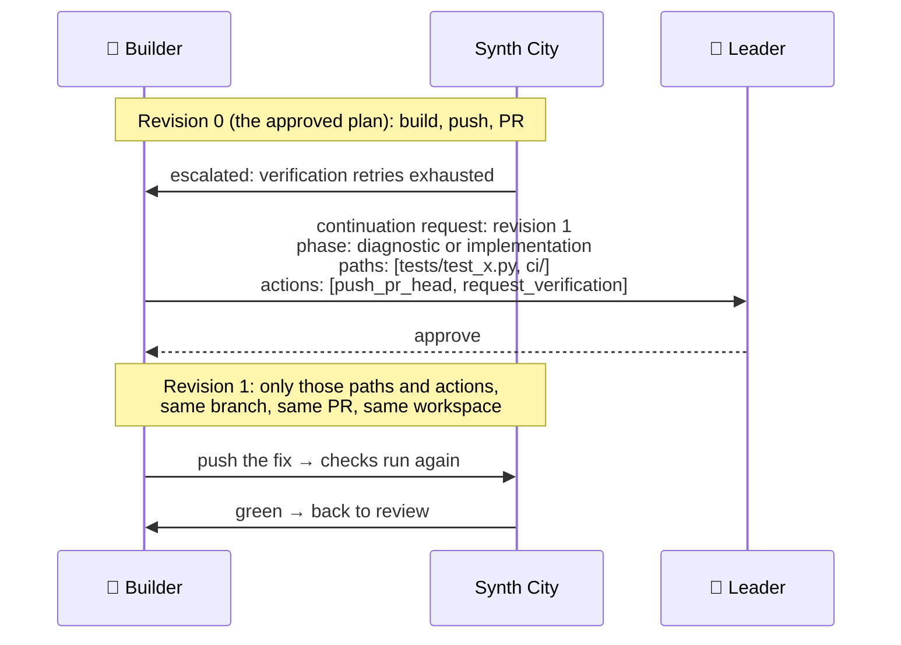

**Two kinds of continuation (the phase):**

| Phase | For | Rule | Example |
|---|---|---|---|
| `diagnostic` | Finding out what's wrong | Temporary changes only; they're **reverted** before the item continues | Add a debug log to a flaky test, read the hosted CI output, then remove the log |
| `implementation` | Fixing it | Changes stay in the PR; they're reviewed and tested again | Re-add a test that an earlier revision removed |

**🧪 A real example (Synth City 3.0, October 2026).** A builder's PR #499 had **no check runs at all**: CI didn't run on PRs into the new release branch until another PR (#498) merged. The item used up its retries waiting for checks that never came, and escalated (`retry_count_exhausted`). The builder's local work was finished but not pushed. A continuation revision allowed exactly two actions (`push_pr_head`, `request_verification`), on that branch only. It also listed what was **not** allowed: no force push, no edits to #498, no workflow changes except one file, no tags or releases. The builder pushed, waited for #498, and the item went back to review **with all its work kept**.

**And the limits?** A continuation can repeat. Without limits, a stubborn item could loop forever: fail, continue, fail, continue. Each limit stops one kind of loop:

| Setting (4.4 value) | Counts | Stops this loop |
|---|---|---|
| `continuation_enabled` (`true`) | — | Off = an escalated item can only be retried from scratch or ended |
| `max_continuation_revisions` (`19`) | Continuation revisions per item | "One more try" without end |
| `max_continuation_failed_heads` (`19`) | Pushes whose checks failed, across all revisions | Pushing guesses until something passes |
| `max_failed_heads_per_revision` (`2`) | Failed pushes inside one revision | One revision that keeps failing: ask for a new, better-scoped one |
| `max_scope_paths` (`48`) | Files and folders one revision may list | A "small" continuation that quietly becomes a rewrite |
| `max_scope_commands` (`24`) | Commands one revision may list | The same, for commands |

When a limit runs out, the item stays escalated. The Leader or the operator then ends it (`end-stopped`) or files a follow-up issue.

**Continuation, amendment, or a new issue?**

| Situation | Use | Why |
|---|---|---|
| The item is **healthy**, and the builder finds it needs one more file (for example, a helper module) | **Amendment**: the Leader approves the extra files | Nothing failed; the plan just grows a little. Limits: 3 approved amendments, 8 requests, 16 added files per item |
| The item is **escalated**, and the next step is small and clear | **Continuation** | Keeps the branch, PR and review history |
| The work turns out to be **a different problem**, or much bigger | **A new issue** (a split) | A new plan, a new review, honest progress counts |
| A **review asks for corrections** inside the approved files | **None of these**: the builder just fixes and pushes | The original plan still covers it |

### 🧩 Coordination policy (optional)

The Leader reviews a list of issues and says which are eligible, blocked or need clarification. Fields: `enabled`, `issue_numbers` (up to 32), `fallback_seconds` (1800), `max_daily_requests` (12).

> [!TIP]
> **💡 Why:** labels say what is *ready*, but not what *depends on what*. With coordination on, the Leader looks at a set of issues and records, for each one, `eligible`, `dependency_blocked`, `human_decision_blocked`, `resource_blocked` or `needs_scope_clarification`. Builders then aren't sent work that can't be finished yet.
>
> **🧪 Example:** the retrospectives page (#1253) needs the snapshot service (#1244) first. The Leader marks #1253 `dependency_blocked` until #1244 merges. `max_daily_requests` keeps the Leader from spending its day re-assessing the list; `fallback_seconds` decides how long to wait for its answer. Most teams can leave coordination off and rely on the Supervisor adding ready labels in dependency order, as 4.4 does.

### 🧱 Dispatch workspaces

One folder per item that may run at once: `POST …/github-scopes/{id}/workspaces` with `{"path": "…/dispatch-1"}`, a sibling of the main clone.

> [!TIP]
> **💡 Why separate folders?** Two builders in one folder would overwrite each other's files and branches. Each item gets its own folder, **leased** to it: Synth City records which item holds it, and nobody else may write there until the item ends. When the item merges, the lease is released and the folder is reused. If an item ends badly, the lease can stay behind, and **force-release** frees it. **No workspaces = nothing dispatches, and no error is shown.** In 4.4, Synth City creates them itself (#948).

---

## 8. The supervisor (optional, recommended for unattended teams)

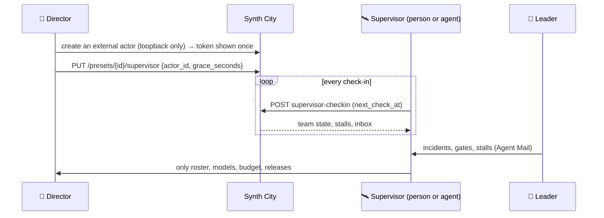

> [!TIP]
> **💡 Why a supervisor, if there's already a Leader?** The Leader is **inside** the team: it coordinates the work, but it can't restart a crashed member, upgrade the factory, or notice that it is itself stuck. The Supervisor watches **from outside**: it checks in on a schedule, reads the team's state and Mail, and handles incidents. It can be you, another person, or an agent (in the Synth City campaigns, a Claude Code session). You, the Director, then deal only with decisions only you can make: the roster, models, budget and releases.
>
> **🧪 Example:** at 03:00 a Codex builder's login expires and it stops. The Leader sends Mail to the Supervisor. The Supervisor's next check-in sees it, restarts the member after a fresh login, and records what happened. The Director reads it in the morning.

| Item | Example | Notes |
|---|---|---|
| External actor | `actor_key`, `display_name`, `kind` | A durable identity with a bearer token. The token is shown **once**; keep it in a file only that user can read. |
| Binding | `actor_id`, `grace_seconds` | One supervisor per team. A check-in missed beyond the grace period is reported as a supervision problem. |
| Escalation order | Leader → Supervisor → Director | Write it in every charter. |

---

## 9. Turning it on, and what happens to an issue

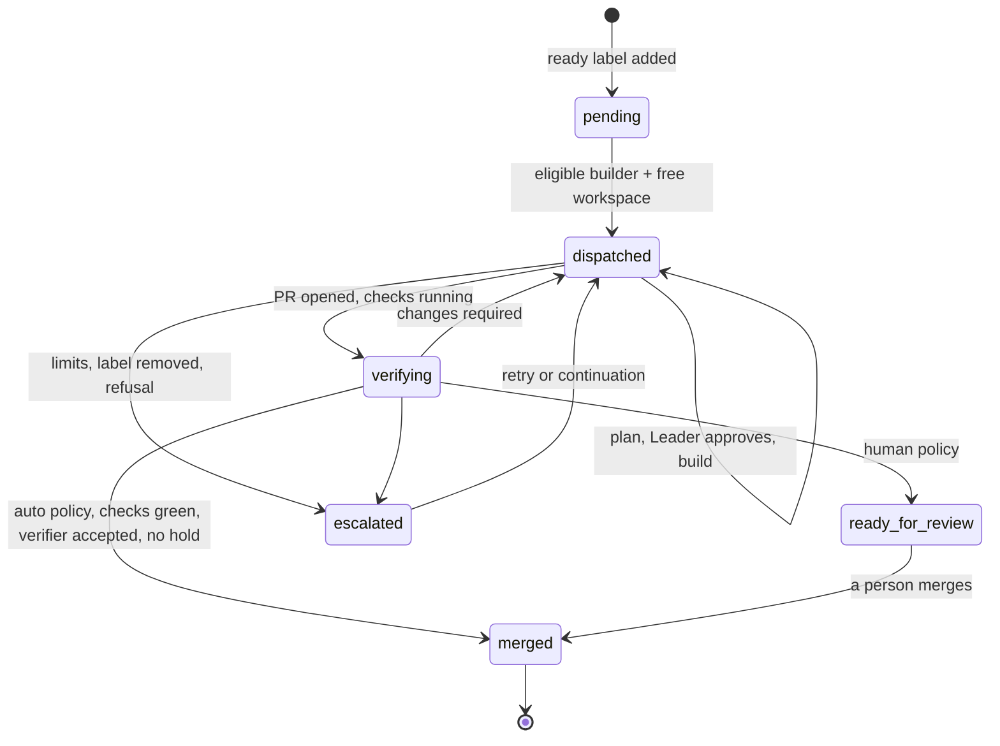

> [!TIP]
> **💡 What "escalated" means:** an item has **stopped and is waiting for a decision**. Nothing is lost: the branch, PR and workspace are kept. Common reasons: a budget ran out (rounds, retries), the ready label was removed during the attempt, the Leader didn't answer in time, or a safety rule refused an action. The Work page shows the reason. The usual next steps are a **continuation** (section 7), a **retry**, or **ending** the item and filing a follow-up.

**Before autonomy on:**
1. `GET …/github-scopes/{id}/activation-readiness`: must have no blockers (Leader bound, a distinct owner, each member's Mail session ready).
2. Enable the scope; check `last_polled_at` advances.
3. Autonomy on, at low concurrency; watch the first item go plan → PR → review → merge, then raise it.

---

## 10. Steering a running campaign

| You want to… | Do this | Avoid |
|---|---|---|
| Start an issue | Add the ready label (+ area, + priority) | — |
| Change the order | Change `priority:N` | Removing ready labels (escalates items) |
| Pause everything | Autonomy off: nothing new is dispatched | Killing tmux sessions |
| Stop now | Create the `HOLD.json` file, or send Mail with **STOP** or **HOLD** in the subject | `pkill` |
| Split a big item | The Leader proposes; you file the parts; remove the ready label from the original | Closing an issue whose item isn't finished |
| Upgrade the factory | Autonomy off → zero dispatched → backup → upgrade → re-check hooks and readiness → autonomy on | Upgrading with items dispatched |
| Unstick a merged item | `POST …/work-items/{id}/finalize-merged` (dry run first) | Editing the database |
| End a stopped item | `POST …/work-items/{id}/end-stopped` | — |
| Free a stale workspace | `POST …/workspaces/{id}/force-release` | Deleting the folder |
| Change models or roster | Autonomy off, edit the slot, relaunch that member | Mid-item swaps |

---

> [!TIP]
> **💡 Three ways to stop, from gentle to firm:**
>
> | | Autonomy off | STOP / HOLD Mail | `HOLD.json` |
> |---|---|---|---|
> | New work | stops | — | stops |
> | Work in progress | continues | the member stops editing until it reads the message | dispatch holds |
> | Use when | an orderly pause (upgrades, the end of the day) | one member must stop now | the whole factory must stop, even if the UI is down |

---

## 11. The whole 4.4 setup on one page

```yaml
team:                     # preset 9
  name: synth-city-v4.4
  backlog_milestone: v4.4
  autonomy_enabled: false        # on at launch
  leader: L1
  slots:
    - {name: L1, provider: codex-cli,  role: coordinator, model: gpt-6.1-terra,  effort: high}
    - {name: B1, provider: codex-cli,  role: implementer, model: gpt-6.2-sol,    effort: xhigh, areas: [v44-core]}
    - {name: B2, provider: codex-cli,  role: implementer, model: gpt-6.2-sol,    effort: xhigh, areas: [v44-infra]}
    - {name: B3, provider: claude-code, role: implementer, model: claude-opus-5-5,   effort: high, areas: [v44-retro]}
    - {name: B4, provider: claude-code, role: implementer, model: claude-sonnet-5-5, effort: high, areas: [v44-ui]}
    - {name: V1, provider: codex-cli,  role: verifier,    model: gpt-6.2-astra,  effort: high}
    - {name: V2, provider: claude-code, role: verifier,    model: claude-opus-5-5,   effort: high}
scope:                    # scope 11
  repo: albiexai/synth-city
  base_ref: origin/release/v4.4
  labels: {ready: synth-city-v44-ready, design: synth-city-v44-design, hold: synth-city-v44-review-hold}
  merge_policy: auto
  max_auto_merges_per_day: 80
  max_concurrent_dispatched: 4
  max_item_effort_minutes: 120
  enabled: false                 # on at launch
  delivery_policy:
    required_checks: [Full backend regression tests, Product CI gate, Changed Python undefined names, e2e, Rename old-name guard]
    broad_checks: hosted
    accepted_base_update: merge
    owner_contact: native
  continuation: {enabled: true, revisions: 19, paths: 48, commands: 24}
  workspaces: [dispatch-7, dispatch-8, dispatch-9, dispatch-10]
supervisor: external actor, bound with a check-in grace
```

---

## 12. Where things stand, and what's changing

| Area | Today (4.3) | Coming in 4.4 | Ideas for 4.5 |
|---|---|---|---|
| Settings in the UI | Delivery policy, hold label, effort limit, supervisor binding: **API only** | All in the UI, with validation and history (#1115) | — |
| Rules that live in charters | Hold removal, plan size: **charter only** | Enforced by the product (#1114) | — |
| Routing | Area labels only | By milestone (#1223) and by difficulty and model (#1109) | — |
| Workspaces and new slots | By hand | Created by Synth City (#948), first launch without hand work (#1262) | — |
| Charters | Written from scratch | Templates in guided setup (#1113) | Team kits |
| Campaign insight | Overview counts | Retrospectives: where the time went, bottlenecks, cost (#944) | — |
| Checking the setup | By hand | — | `synth-city doctor` and an Installation page (#979) |

### Decisions on the open questions (Director, 2026-11-24)

| Question | Decision | Resolved in |
|---|---|---|
| **Which settings are per team, which per installation?** | About the **machine** (tokens, port, database, agent user, HOLD path, memory) → per installation. About the **repository** (checks, labels, merge policy, limits) → per scope. About **how a team works** (idle and nudge timers, Mail unanswered time, wake follow-up) → an installation default with an **optional team override**, as the Leader ack windows already work. | **4.4**: #1115 |
| **Roster presets in guided setup?** | Yes, as the first **team kits**: **Minimal** (Leader, builder, verifier), **Small** (Leader, two builders, verifier), **Large** (the 4.4 line-up). Each carries the charter templates and cautious defaults (human merge policy, a low daily cap). Presets fix roles and harnesses, **not models**: you choose models for your subscriptions, and the large roster warns about quota. | **4.5**: team kits (#979) |
| **Show the `.env` settings in the UI?** | Yes, **read-only**: each setting's value and where it comes from (default, `.env`, environment); secrets only as "set" or "not set"; a "restart needed" marker when the file differs from what's running. Never editable from the web app. | **4.4**: #1280, if reached; otherwise **4.5**: Installation page |
| **The minimum before autonomy, enforced by readiness?** | Yes. **Blockers** (no override): operator token set; GitHub can read the repository; the base branch exists and CI runs on PRs into it; a dispatch workspace is registered; the ready label exists; builders' lane labels match; for auto merge, a verifier and required checks. **Warnings** (acknowledged once, recorded): no supervisor; no recent backup; auto merge or a high cap on a first campaign; an Admin token for the agents. The same checks as `synth-city doctor`. | **4.5**: installation health (#979) |

---

## 📖 Glossary

| Word | Meaning |
|---|---|
| **Attempt** | One try at an issue: from dispatch to merge or stop. A retry is a new attempt. |
| **Dispatch** | Giving a ready issue to a builder, with a workspace and a brief. |
| **Escalated** | Stopped, waiting for a decision. Work is kept. |
| **Head** | The latest commit on a PR's branch. Reviews and checks apply to one exact head. |
| **Lease** | An item's exclusive right to a workspace folder. |
| **Plan / scope revision** | The approved list of files, commands and actions for an attempt. Revision 0 is the first plan; continuations are revisions 1, 2, … |
| **Amendment** | Adding files to an approved plan while the item is healthy. |
| **Continuation** | A new, bounded revision for an escalated item, on the same branch and PR. |
| **Review hold** | A GitHub label that blocks automatic merge until the accepting verifier removes it. |
| **Required check** | A CI job that must be green before merge, named in the delivery policy. |
| **Scope** | One watched repository and the rules for working on it, per team. |
| **Slot** | One seat in a team: its harness, model, folder, role and charter. The agent in it is the member. |
| **Supervisor** | An external person or agent who watches the team from outside and handles incidents. |
| **Director** | You: roster, models, budget, releases. |
