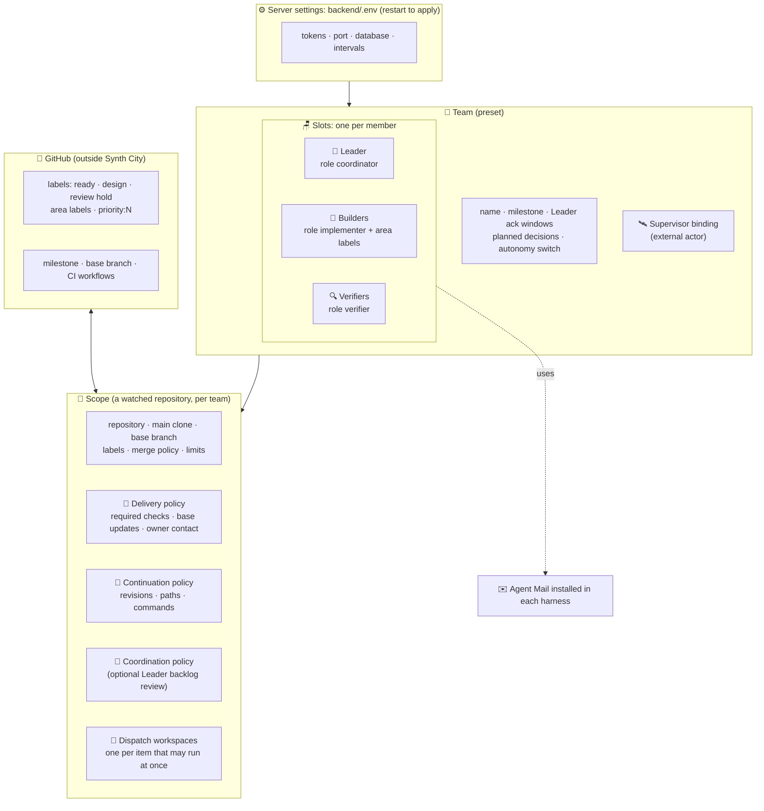
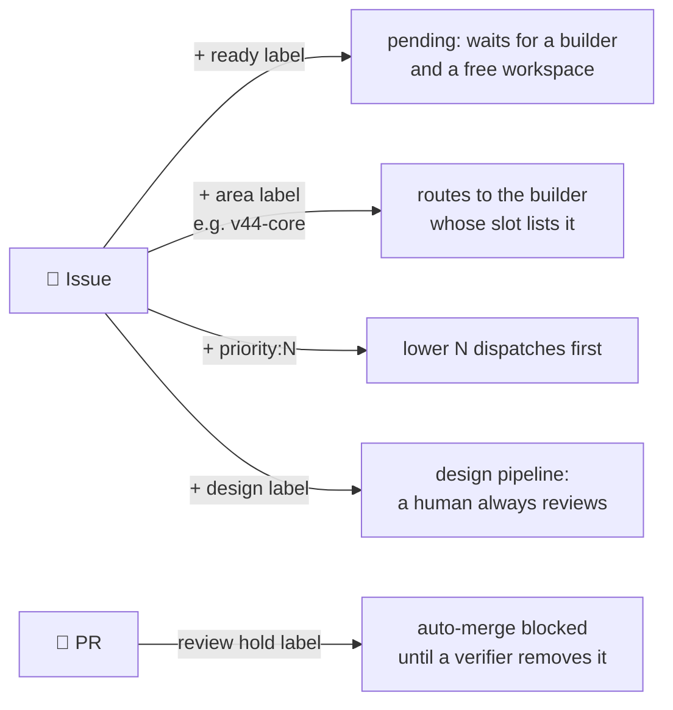
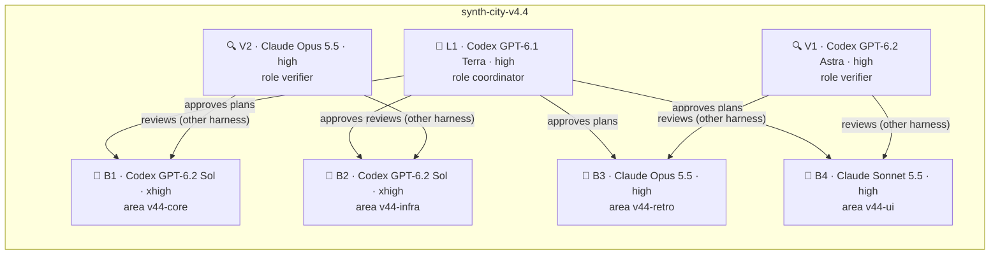
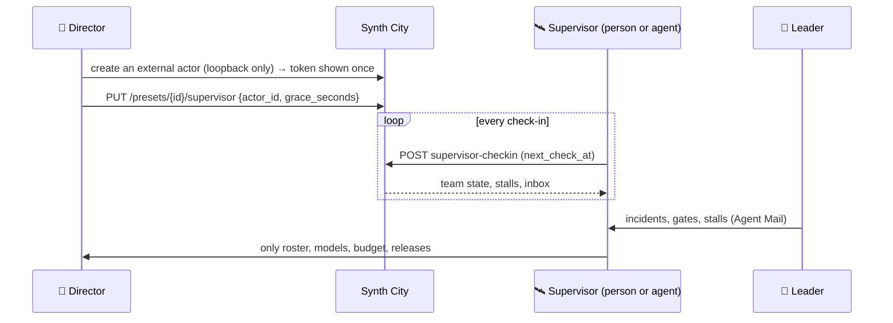
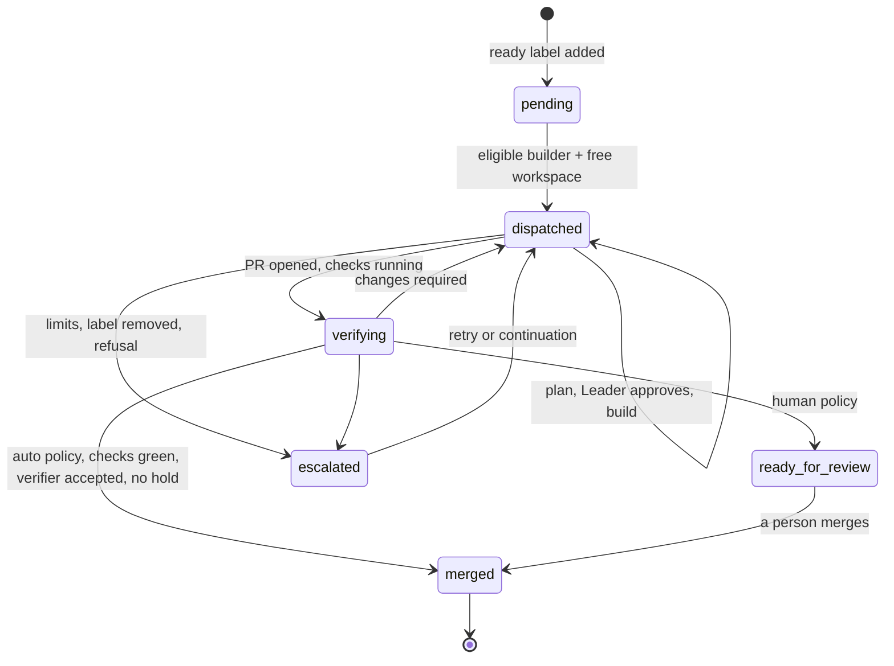

# 🎛️ Guide 3 — Operating the factory: what to configure after installing

> [!NOTE]
> **Status: current situation, 22 Nov 2026 (Synth City 4.3.0; 4.4 is in preparation).** This guide is for the **operator / Director**: the person who decides what the factory works on, with which agents, under which rules. It begins right after **Guide 1** (single user) or **Guide 2** (dedicated factory), and applies to both. Every parameter below is the real field name, with its default and an example from the Synth City 4.4 team.

---

## 1. The map: what you configure



| Layer | Where you change it | How often | Who may change it |
|---|---|---|---|
| ⚙️ Server settings | `backend/.env`, then restart | Once, at install | Whoever administers the host |
| 🐙 GitHub labels, milestone, branch, CI | GitHub | Once per campaign | Repository maintainers |
| 👥 Team and 🪑 slots | **Teams** page, or `/api/v1/agent-teams/presets…` | Once per campaign; slots when the roster changes | Operator (needs the operator token) |
| 📂 Scope | **Repositories** page (guided setup), or `/api/v1/agent-teams/github-scopes…` | Once per campaign, adjusted mid-campaign | Operator |
| 📜 Delivery policy, supervisor binding, hold label, effort limit | **API only today** (UI coming in 4.4, #1115) | Rarely | Operator |
| ▶️ Autonomy | **Teams** page | Every start and stop | Operator |

> [!IMPORTANT]
> **The operator token** (`OPERATOR_TOKEN` in `backend/.env`) protects every change to teams, scopes, autonomy and recovery. The UI asks for it once per browser tab. API calls send it as the header `X-Synth-City-Operator-Token`. Never paste it into Agent Mail, an issue or a chat.

---

## 2. Day one, in order

```mermaid
flowchart LR
    A["1️⃣ Server settings<br/>tokens, restart"] --> B["2️⃣ GitHub<br/>labels, branch, CI"]
    B --> C["3️⃣ Agent Mail<br/>install per harness"]
    C --> D["4️⃣ Team<br/>+ slots + Leader"]
    D --> E["5️⃣ Scope<br/>disabled at first"]
    E --> F["6️⃣ Policies<br/>delivery, continuation"]
    F --> G["7️⃣ Workspaces"]
    G --> H["8️⃣ Launch team<br/>check members"]
    H --> I["9️⃣ Readiness clear<br/>→ enable scope"]
    I --> J["🔟 Autonomy on<br/>low concurrency"]
    J --> K["➕ Ready labels<br/>on issues"]
```



---

## 3. Server settings (`backend/.env`)

Nothing here is needed to **start** Synth City. These matter when you run teams and autonomy. Names are case-insensitive (`operator_token` = `OPERATOR_TOKEN`).

| Setting | Default | Example | What it decides |
|---|---|---|---|
| `OPERATOR_TOKEN` | *(empty)* | `openssl rand -hex 32` | Protects all operator changes. **Set it.** |
| `GITHUB_TOKEN` | *(empty)* | a token with repo access | Polling issues, PRs and checks. Required for autonomy. |
| `GITHUB_APP_ID`, `GITHUB_APP_PRIVATE_KEY_PATH`, `GITHUB_APP_BOT_LOGIN` | *(empty)* | — | Optional: dispatch as a GitHub App bot instead of your login. |
| `HOST`, `PORT` | `127.0.0.1`, `8000` | `127.0.0.1`, `8011` | Where the backend listens. Keep it on localhost. |
| `DATABASE_URL` | `sqlite+aiosqlite:///./synth_city.db` | a path in the state folder | Relative to the working folder; use an absolute path on a factory. |
| `HARNESS_AGENT_USER` | *(none)* | `synthagent` | Dedicated only: whose `~/.claude` the Harnesses pages show as "global". |
| `MAIL_CAPABILITY_TOKENS_REQUIRED` | `true` | `true` | Agents prove their session for Mail writes (Linux). |
| `GITHUB_DISPATCH_INTERVAL_SECONDS` | `60` | `60` | How often the watcher polls GitHub. |
| `GITHUB_MIN_AVAILABLE_MEMORY_MB` | `3000` | `3000` | Dispatch pauses when free memory is below this. |
| `GITHUB_LEADER_ACK_TIMEOUT_SECONDS` / `…_MAX_WAIT_SECONDS` | `300` / `1800` | — | Default time for the Leader to answer a plan (the team can override). |
| `GITHUB_OWNER_IDLE_TIMEOUT_SECONDS` | `900` | — | When an idle builder is nudged. |
| `MAIL_REQUEST_UNANSWERED_SECONDS` | `1200` | — | When an unanswered Mail request counts as stalled. |
| `GITHUB_COORDINATION_HOLD_PATHS` | *(none)* | `…/operations/HOLD.json` | Emergency stop: while this file exists, dispatch holds. |
| `GITHUB_PUBLISH_SUMMARIES_ENABLED` | `false` | `true` | Synth City posts its own work summaries on issues and PRs. |

<details>
<summary>More timing and nudge settings (rarely changed)</summary>

`GITHUB_CHECK_SIGNAL_GRACE_SECONDS` (120) · `GITHUB_OWNER_REGISTRATION_GRACE_SECONDS` (120) · `GITHUB_DESIGN_ACK_MULTIPLIER` (3) · `GITHUB_TEAM_IDLE_TIMEOUT_SECONDS` (1800) · `WAKE_FOLLOWUP_ENABLED` (true) / `WAKE_FOLLOWUP_DELAY_SECONDS` (120) · `GITHUB_NUDGE_GRACE_SECONDS` (180) · `GITHUB_STALE_LEASE_BACKSTOP_SECONDS` (21600) · `GITHUB_BRIEF_DELIVERY_MAX_NUDGES` (2) · `GITHUB_CONTINUATION_PROPOSAL_EXPIRY_SECONDS` (3600) · the `…_NUDGE_COOLDOWN_SECONDS` settings (180) · `BRIDGE_ATTACHMENT_*` (image paste into sessions: folder, 10 MB, 7 days, 100 per day).
</details>

---

## 4. GitHub: the factory reads labels, not minds



| GitHub item | Example (4.4) | Effect |
|---|---|---|
| **Ready label** (`dispatch_label`) | `synth-city-v44-ready` | Adding it queues the issue. Removing it **during** an attempt escalates the attempt. |
| **Design label** (`design_label`) | `synth-city-v44-design` | The issue produces a design PR; design PRs always need a human. |
| **Review hold label** (`review_hold_label`) | `synth-city-v44-review-hold` | While on the PR or issue, auto-merge waits. Builders add it; the accepting verifier removes it. |
| **Area labels** | `v44-core`, `v44-infra`, `v44-retro`, `v44-ui` | Routing: the first enabled builder (in roster order) whose `area_labels` include one of the issue's labels. Exact match, case-sensitive. No match = stays pending (`no_eligible_owner`). |
| **Priority labels** | `priority:1` … `priority:30` | Queue order: lowest first. |
| **Milestone** | `v4.4` | The team's `backlog_milestone`: campaign progress on Overview. |
| **Base branch** | `release/v4.4` | Where PRs go. **Its CI must run on PRs into that branch**, or no checks appear and nothing merges. |
| **CI checks** | `e2e`, `Product CI gate`, … | Named in the delivery policy's `required_checks`. |

> [!TIP]
> One label per lane, and one priority per issue, give the Leader and the builders a clear queue. Never hold a queue by removing ready labels: that escalates items. Give an item a higher priority number instead, or turn autonomy off.

---

## 5. The team (preset)

| Field | Default | Example (4.4) | What it decides |
|---|---|---|---|
| `name` | — | `synth-city-v4.4` | Unique. One team per campaign is a good habit (duplicate the last one). |
| `description` | — | "the multi-team core and campaign retrospectives…" | Shown on Teams and to agents. |
| `backlog_milestone` | *(none)* | `v4.4` | Campaign progress counts on Overview. |
| `parent_issue_url` | *(none)* | a tracking issue URL | Alternative to a milestone for progress. |
| `planned_decisions` | *(none)* | up to 12 lines, each `later` / `now` / `done` | Decisions you plan to take during the campaign; shown to the Leader. |
| `leader_ack_timeout_seconds` | server default (300) | `300` | How long the Leader has to acknowledge a plan request (30–86 400). |
| `leader_ack_max_wait_seconds` | server default (1800) | `1800` | The hard limit before escalation (≥ the timeout). |
| **Leader** (`PUT …/presets/{id}/leader`) | *(none)* | slot L1 | Leader authority: approves plans, never owns an issue. Only while autonomy is off. |
| `autonomy_enabled` | `false` | `false` until launch | The master switch for dispatch. |

> [!NOTE]
> **Duplicate, don't rebuild.** `POST /presets/{id}/duplicate` copies every slot, its charter and launch options, and the Leader. Change what's new, and clear any copied `session_id` so each member starts a fresh conversation.

---

## 6. Slots: one per team member



| Field | Default | Example | What it decides |
|---|---|---|---|
| `display_name` | — | `B1 GPT-6.2 Sol builder (core)` | Shown everywhere; name the role and model. |
| `provider` | `codex-cli` | `codex-cli` or `claude-code` | The harness (also `copilot-cli`, `opencode-cli`, `pi-cli`, …). |
| `role` | *(none)* | `coordinator` / `implementer` / `verifier` | `coordinator` is never routed work. Only `verifier` slots can accept a head for auto-merge. |
| `repo_path` | — | `…/work/v41/build-1` | The member's own folder. Its repository must match the scope's. |
| `area_labels` | *(none)* | `["v44-core"]` | Routing: which issues this builder takes. |
| `charter` | *(none)* | the member's rules, in plain sentences | **The most important field.** See below. |
| `bootstrap_prompt` | *(none)* | "Read your charter, then the v4.4 issues: …" | First message at launch. |
| `launch_mode` | `plain` | `plain` → later `resume` | `plain` starts fresh; `resume` continues `launch_options.session_id`. Codex: `fork` too. |
| `launch_options` | `{}` | see the next table | CLI flags for the harness. |
| `controlled_language_enabled` | `true` | `true` | Asks the agent to write short ASD-STE100 sentences. |
| `expertise` | *(none)* | — | Stored; **does not route work yet** (4.4: #1109). |
| `enabled` | `true` | `true` | A disabled slot gets no work and can't accept reviews. |
| `ui_color`, `position` | — | — | Display only. |

### Launch options for Claude Code and Codex

| Option | Claude Code | Codex CLI | Example |
|---|---|---|---|
| `model` | `--model` (a concrete id) | `--model` | `claude-opus-5-5` · `gpt-6.2-sol` |
| `reasoning_effort` | `--effort`: `low` `medium` `high` `xhigh` `max` | `model_reasoning_effort` | `high`, `xhigh` |
| `skip_permissions` | `--dangerously-skip-permissions` | — | `true` for unattended members |
| `dangerously_bypass_approvals_and_sandbox` | — | bypass approvals and sandbox | `true` for unattended members |
| `sandbox`, `approval_policy` | — | `--sandbox`, `--ask-for-approval` | instead of the bypass, if you prefer limits |
| `no_alt_screen` | — | `--no-alt-screen` | `true` (keeps the pane readable for observation) |
| `session_id` | `--resume <id>` (in `resume` mode) | resume that rollout | filled in after the first launch |
| `use_last` | — | resume the last session | `false` for team members |
| `profile` | — | `--profile` | a Codex profile name |

> [!WARNING]
> Unattended members need the bypass options, **or they stop at the first permission prompt and wait for no one**. That's why the charter, the review hold and the verifier carry the safety, not the harness's prompts.

### What goes in a charter (practices that worked in 4.1–4.3)

| Rule | Why |
|---|---|
| Plan size limit (about 60 active minutes, 150–400 lines) | Bigger plans fail review and stall; split them. |
| Focused tests locally; full suites on CI | Saves an hour per item; CI runs in parallel with review. |
| A test evidence block on every handoff | The verifier trusts the run without repeating it. |
| Every PR carries the review hold label; only the accepting verifier removes it | The merge gate, until 4.4 makes it a product rule (#1114). |
| Never use interactive question tools | No one answers; the agent waits for hours. |
| The escalation order: Leader → Supervisor → Director | Questions go to whoever can decide. |
| Process safety: never `pkill` or pattern kills | All members share one OS user. |
| PRs target the release branch, never `master` | Nothing reaches `master` before the release. |

4.4 ships charter **templates** for these (#1113).

---

## 7. The scope: a watched repository

| Field | Default | Example (4.4) | What it decides |
|---|---|---|---|
| `repo_owner` / `repo_name` | — | `albiexai` / `synth-city` | The GitHub repository. |
| `repo_path` | — | `…/work/v41/deck-source` | An existing main clone. Dispatch worktrees are created beside it. |
| `base_ref` | `origin/HEAD` | `origin/release/v4.4` | What each item branches from and targets. |
| `dispatch_label` | `albiex-synth-city-ready` | `synth-city-v44-ready` | The ready label. |
| `design_label` | `albiex-synth-city-design` | `synth-city-v44-design` | The design label. |
| `review_hold_label` | *(none)* | `synth-city-v44-review-hold` | Blocks auto-merge while present (**API only today**). |
| `merge_policy` | `human` | `auto` | `human`: PRs wait for a person. `auto`: merge when checks are green, a verifier accepted the exact head, and no hold label. |
| `max_auto_merges_per_day` | `5` | `80` | A cap on automatic merges. |
| `max_concurrent_dispatched` | `3` | `4` | Items running at once. Needs that many workspaces. |
| `max_item_effort_minutes` | `120` | `120` | The most active effort for one item (15–1440; **API only today**). |
| `max_approval_rounds` | `3` | `3` | Plan rounds before escalation. |
| `max_verification_retries` | `2` | `2` | Review/CI retries before escalation. |
| `github_auth_mode` | `unknown` | `ambient` | `ambient` uses the host's login; `app` uses the GitHub App. |
| `builds_out_of_tree`, `build_dir_template`, `build_command_hint`, `max_build_parallelism` | `false`, `build`, —, `4` | defaults | For compiled projects (for example, meson builds outside the source tree). |
| `enabled` | `true` | **`false` until launch** | Whether the watcher polls this scope. |

### 📜 Delivery policy (per scope, versioned, with history) — API only today

| Field | Default | Example (4.4) | What it decides |
|---|---|---|---|
| `required_checks` | `[]` | 5 checks: `Full backend regression tests`, `Product CI gate`, `Changed Python undefined names`, `e2e`, `Rename old-name guard` (app `github-actions`) | The checks that must be green to merge. **A head with no check runs is not green.** |
| `broad_checks` | `local` | `hosted` | `hosted`: full suites run on CI, builders run focused tests (needs required checks). |
| `accepted_base_update` | `disabled` | `merge` | After acceptance, bring the PR up to date with its base by merge (or `fast_forward`). |
| `owner_contact` | `reports` | `native` | `native`: Synth City reads the builder's own activity instead of waiting for reports. |
| `owner_idle_seconds` | *(server)* | `1800` | Idle time before an owner nudge. |
| `owner_nudge_grace_seconds` | *(server)* | `120` | Grace after a nudge. |
| `owner_observation_wait_seconds` / `…_resume_seconds` | — / `900` | `60` / `900` | Native observation timing. |
| `checkpoint_delay_report_seconds` | `1800` | `600` | When a slow checkpoint is reported. |
| `caller_inventory_required`, `regression_proof_required` | `false` | `false` | Ask builders for extra evidence. |

Change it with `PATCH …/github-scopes/{id}/delivery-policy` with `expected_revision` and a `reason`. Every change is kept in its history.

### 🔁 Continuation policy (when an approved plan needs more)

| Field | Example | What it decides |
|---|---|---|
| `continuation_enabled` | `true` | Builders may ask for a bounded follow-up revision instead of a new issue. |
| `max_continuation_revisions` | `19` | Revisions per item. |
| `max_continuation_failed_heads` / `max_failed_heads_per_revision` | `19` / `2` | Failed pushes allowed. |
| `max_scope_paths` / `max_scope_commands` | `48` / `24` | How big an approved scope may grow. |

### 🧩 Coordination policy (optional)

The Leader reviews a list of issues and says which are eligible, blocked or need clarification. Fields: `enabled`, `issue_numbers` (up to 32), `fallback_seconds` (1800), `max_daily_requests` (12).

### 🧱 Dispatch workspaces

One folder per item that may run at once: `POST …/github-scopes/{id}/workspaces` with `{"path": "…/dispatch-1"}`, a sibling of the main clone. **No workspaces = nothing dispatches, and no error is shown.** In 4.4, Synth City creates them itself (#948).

---

## 8. The supervisor (optional, recommended for unattended teams)



| Item | Example | Notes |
|---|---|---|
| External actor | `actor_key`, `display_name`, `kind` | A durable identity with a bearer token. The token is shown **once**; keep it in a file only that user can read. |
| Binding | `actor_id`, `grace_seconds` | One supervisor per team. A check-in missed beyond the grace period is reported as a supervision problem. |
| Escalation order | Leader → Supervisor → Director | Write it in every charter. |

---

## 9. Turning it on, and what happens to an issue



**Before autonomy on:**
1. `GET …/github-scopes/{id}/activation-readiness`: must have no blockers (Leader bound, a distinct owner, each member's Mail session ready).
2. Enable the scope; check `last_polled_at` advances.
3. Autonomy on, at low concurrency; watch the first item go plan → PR → review → merge, then raise it.

---

## 10. Steering a running campaign

| You want to… | Do this | Avoid |
|---|---|---|
| Start an issue | Add the ready label (+ area, + priority) | — |
| Change the order | Change `priority:N` | Removing ready labels (escalates items) |
| Pause everything | Autonomy off: nothing new is dispatched | Killing tmux sessions |
| Stop now | Create the `HOLD.json` file, or send Mail with **STOP** or **HOLD** in the subject | `pkill` |
| Split a big item | The Leader proposes; you file the parts; remove the ready label from the original | Closing an issue whose item isn't finished |
| Upgrade the factory | Autonomy off → zero dispatched → backup → upgrade → re-check hooks and readiness → autonomy on | Upgrading with items dispatched |
| Unstick a merged item | `POST …/work-items/{id}/finalize-merged` (dry run first) | Editing the database |
| End a stopped item | `POST …/work-items/{id}/end-stopped` | — |
| Free a stale workspace | `POST …/workspaces/{id}/force-release` | Deleting the folder |
| Change models or roster | Autonomy off, edit the slot, relaunch that member | Mid-item swaps |

---

## 11. The whole 4.4 setup on one page

```yaml
team:                     # preset 9
  name: synth-city-v4.4
  backlog_milestone: v4.4
  autonomy_enabled: false        # on at launch
  leader: L1
  slots:
    - {name: L1, provider: codex-cli,  role: coordinator, model: gpt-6.1-terra,  effort: high}
    - {name: B1, provider: codex-cli,  role: implementer, model: gpt-6.2-sol,    effort: xhigh, areas: [v44-core]}
    - {name: B2, provider: codex-cli,  role: implementer, model: gpt-6.2-sol,    effort: xhigh, areas: [v44-infra]}
    - {name: B3, provider: claude-code, role: implementer, model: claude-opus-5-5,   effort: high, areas: [v44-retro]}
    - {name: B4, provider: claude-code, role: implementer, model: claude-sonnet-5-5, effort: high, areas: [v44-ui]}
    - {name: V1, provider: codex-cli,  role: verifier,    model: gpt-6.2-astra,  effort: high}
    - {name: V2, provider: claude-code, role: verifier,    model: claude-opus-5-5,   effort: high}
scope:                    # scope 11
  repo: albiexai/synth-city
  base_ref: origin/release/v4.4
  labels: {ready: synth-city-v44-ready, design: synth-city-v44-design, hold: synth-city-v44-review-hold}
  merge_policy: auto
  max_auto_merges_per_day: 80
  max_concurrent_dispatched: 4
  max_item_effort_minutes: 120
  enabled: false                 # on at launch
  delivery_policy:
    required_checks: [Full backend regression tests, Product CI gate, Changed Python undefined names, e2e, Rename old-name guard]
    broad_checks: hosted
    accepted_base_update: merge
    owner_contact: native
  continuation: {enabled: true, revisions: 19, paths: 48, commands: 24}
  workspaces: [dispatch-7, dispatch-8, dispatch-9, dispatch-10]
supervisor: external actor, bound with a check-in grace
```

---

## 12. Where things stand, and what's changing

| Area | Today (4.3) | Coming in 4.4 | Ideas for 4.5 |
|---|---|---|---|
| Settings in the UI | Delivery policy, hold label, effort limit, supervisor binding: **API only** | All in the UI, with validation and history (#1115) | — |
| Rules that live in charters | Hold removal, plan size: **charter only** | Enforced by the product (#1114) | — |
| Routing | Area labels only | By milestone (#1223) and by difficulty and model (#1109) | — |
| Workspaces and new slots | By hand | Created by Synth City (#948), first launch without hand work (#1262) | — |
| Charters | Written from scratch | Templates in guided setup (#1113) | Team kits |
| Campaign insight | Overview counts | Retrospectives: where the time went, bottlenecks, cost (#944) | — |
| Checking the setup | By hand | — | `synth-city doctor` and an Installation page (#979) |

### Questions to refine with this guide

1. Which settings should be **per team** and which **per installation**? (Today, timing settings are per installation in `.env`, and limits are per scope.)
2. Should guided setup offer **presets** for common rosters (solo, small team, the 4.4 line-up)?
3. Should the server settings in `.env` become visible (read-only) in the UI, so an operator sees what is in force?
4. What is the minimum a new operator must set before autonomy is allowed? Should readiness enforce it?
